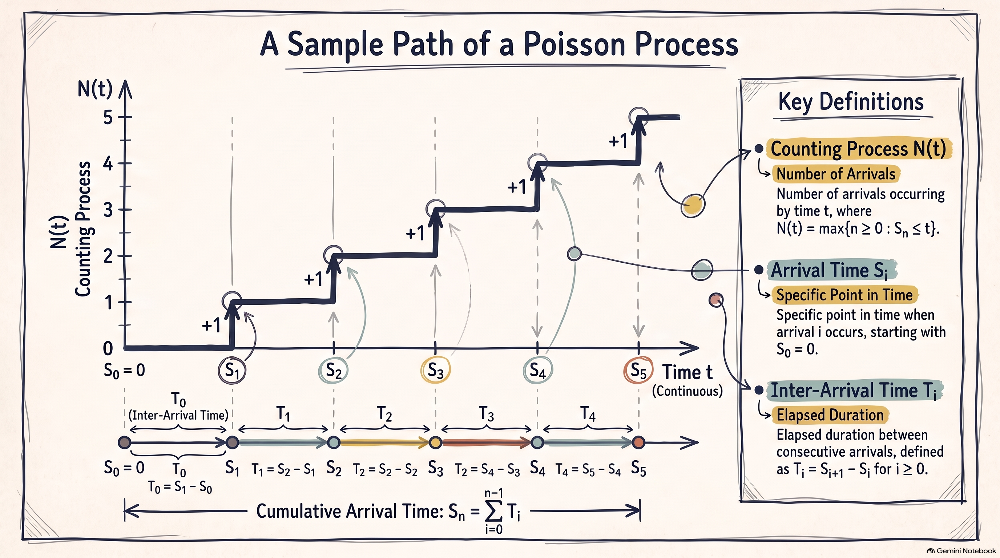
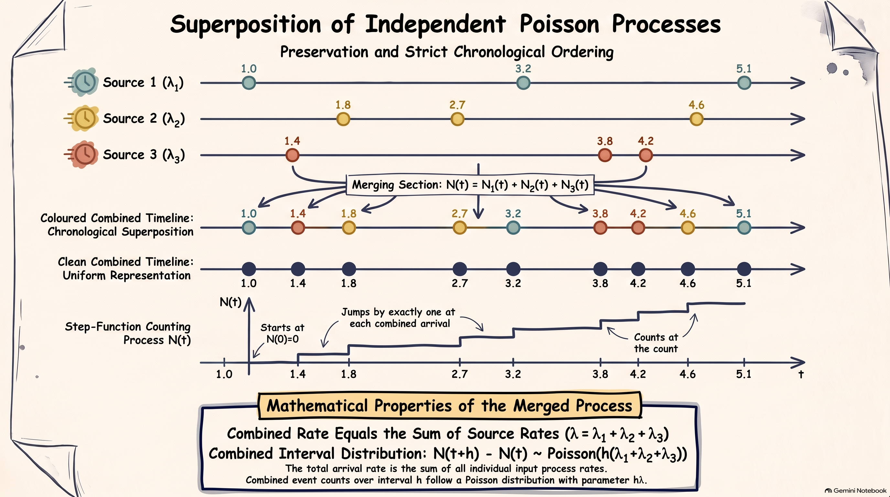
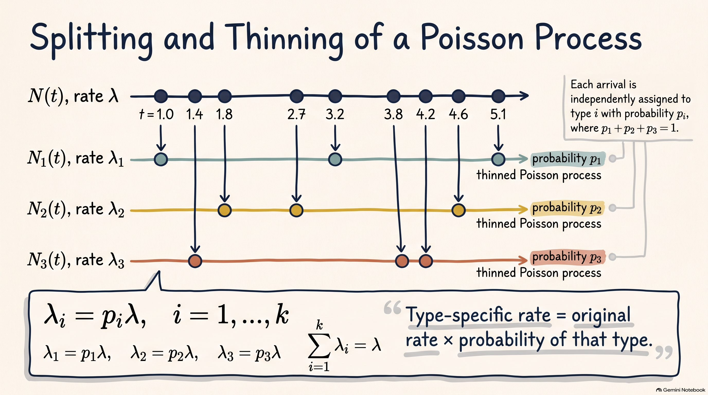

## Chapter 3: Poisson Processes

### Learning Outcomes {.unnumbered}

After studying this chapter, students should be able to:

1. **Define and describe** a homogeneous Poisson process and explain its main assumptions and properties.
2. **Calculate** probabilities, expected values, and variances associated with the number of events occurring during a given time interval.
3. **Describe and apply** the exponential distribution of inter-arrival times and the gamma distribution of arrival times.
4. **Explain and apply** the independent-increments, stationary-increments, and memoryless properties of a Poisson process.
5. **Apply** the superposition and thinning properties to model arrivals from multiple sources and different categories of events.
6. **Determine** the conditional distributions of event times and event counts, given the total number of events during a specified period.
7. **Explain** the relationship between a Poisson process and a continuous-time Markov chain, including the two-state Alive–Dead model.

## Introduction to Poisson Processes {#introduction-to-poisson-processes}

### Motivation

Many real-world systems involve events occurring randomly over time. Examples include insurance claims, customer arrivals, telephone calls, and equipment failures.

In previous chapters, we studied Markov chains, which describe how a system evolves through a sequence of discrete time steps. We now consider stochastic processes in which events can occur at any time within a continuous time interval.

A **Poisson process** provides a mathematical model for counting the number of events that occur over time and studying the times at which they occur. It is widely used in actuarial science, finance, telecommunications, and other fields where random arrivals or occurrences need to be modelled.

### From Markov Chains to Poisson Processes

A discrete-time Markov chain describes the evolution of a system at times $n=0,1,2,\ldots$. The system changes state at discrete time steps, and its future behaviour depends on its current state, given the past.

A Poisson process takes a different approach. Rather than tracking changes in the state of a system at discrete time steps, it counts the number of events that have occurred by time $t$, where $t\geq 0$ is continuous.

For example, an insurer may be interested in the number of claims received during a day. Claims can arrive at any time, rather than only at the beginning or end of each hour.

The main distinction is therefore the time parameter: a discrete-time Markov chain evolves in discrete time, whereas a Poisson process describes event occurrences in continuous time. A Poisson process is also a continuous-time Markov process, a connection that will become clearer when we study its properties.

### Counting Events over Time

Let $N(t)$ denote the number of events that have occurred during the time interval $(0,t]$, where $t\geq 0$.

The process $\{N(t):t\geq 0\}$ tracks the cumulative number of events over time. For example, consider the arrival of insurance claims:

- Initially, no claims have occurred, so $N(0)=0$.
- If three claims have occurred by time $t=5$, then $N(5)=3$.
- If two more claims occur between times $5$ and $8$, then $N(8)=5$.

Thus, $N(t)$ is a non-negative integer-valued quantity that does not decrease as time increases. It increases by one whenever a new event occurs.

The number of events occurring between times $s$ and $t$, where $0\leq s<t$, is given by

$$
N(t)-N(s).
$$

This notation allows us to study both the total number of events over a period and the number of events occurring within a particular time interval.

<!-- ### Applications -->

<!-- Poisson processes are used to model event arrivals in many fields. Examples include: -->

<!-- - **Insurance:** The number of claims reported to an insurer over a specified period. -->
<!-- - **Finance:** The arrival of credit defaults or certain types of financial events. -->
<!-- - **Telecommunications:** The number of calls received by a call centre over time. -->
<!-- - **Transportation:** The number of accidents occurring on a highway. -->
<!-- - **Healthcare:** The number of patients arriving at an emergency department. -->

<!-- In each case, the Poisson process provides a framework for modelling the frequency and timing of events. However, the suitability of the model depends on whether its assumptions reasonably describe the underlying event-generating mechanism. -->


### Applications

Poisson processes are used to model the occurrence of events over time. They are particularly useful when events occur individually, at irregular times, and at an approximately constant average rate. The rate parameter, $\lambda$, describes the average number of events occurring per unit of time.

The following examples illustrate how Poisson processes can be applied in different fields.

- **Insurance:** An insurer may use a Poisson process to model the arrival of claims from a portfolio of policyholders. For example, if claims arrive at an average rate of 20 per day, the model assumes that the number of claims reported during an interval of length $t$ follows a Poisson distribution with mean $20t$. This provides a basis for estimating the probability of receiving a particular number of claims over a specified period.

- **Finance:** A Poisson process can be used to model the arrival of certain financial events, such as credit defaults within a portfolio or the occurrence of operational losses. For example, if defaults occur at an average rate of 3 per year, the model can be used to estimate the probability of observing a given number of defaults over the next five years. In practice, the assumption of a constant rate may need to be adjusted to account for changes in economic conditions.

- **Telecommunications:** The number of telephone calls received by a call centre can be modelled using a Poisson process. If calls arrive at an average rate of 30 per hour, the model can be used to estimate the probability of receiving more than 35 calls during the next hour. Such estimates can help determine staffing requirements and assess the capacity needed to handle incoming calls.

- **Transportation:** A Poisson process may be used to model the number of traffic accidents occurring along a particular stretch of highway. If accidents occur at an average rate of 2 per month, the model can be used to estimate the probability of observing no accidents or several accidents during a specified period. The model may be less appropriate when accident rates vary substantially with traffic volume, weather conditions, or seasonal patterns.

- **Healthcare:** The arrival of patients at an emergency department can be modelled using a Poisson process. If patients arrive at an average rate of 8 per hour, the model can be used to estimate the probability of receiving a particular number of patients during the next hour. These estimates can support decisions about staffing levels and resource allocation.

In each application, the Poisson process provides a framework for studying both the number of events and their timing. For a homogeneous Poisson process, the model assumes that:

1. Events occur independently, so the number of events in one time interval does not affect the number in a disjoint time interval.
2. The average rate of occurrence, $\lambda$, remains constant over time.
3. The probability of two or more events occurring in a sufficiently short time interval is negligible compared with the probability of a single event.

These assumptions determine whether a homogeneous Poisson process is a suitable model. For example, patient arrivals may be more frequent during certain hours, while insurance claims may be affected by seasonal weather conditions. In such situations, a constant-rate model may be inadequate, and a more general model, such as a non-homogeneous Poisson process, may be required.

### Questions of Interest

Suppose insurance claims arrive according to a Poisson process with an average rate of $\lambda=20$ claims per day.

Several questions may arise:

1. What is the probability that more than 100 claims arrive during a seven-day period?
2. What is the expected waiting time until the next claim?
3. What is the probability that no claims occur during the next two hours?
4. Given that exactly 10 claims occur during a particular day, what is the probability that three of them occur during the first six hours?

These questions concern different aspects of the same process:

- The first and third questions concern the number of events occurring within a specified time interval.
- The second question concerns the waiting time until an event occurs.
- The fourth question concerns the distribution of event counts conditional on the total number of events.

A Poisson process provides a unified mathematical framework for answering these questions. The following sections develop the relevant probability distributions and properties.


## Definition and Properties of the Poisson Process {#definition-and-properties-of-the-poisson-process}

### Two Approaches to Defining a Poisson Process

A Poisson process models the occurrence of events over time, such as insurance claims, customer arrivals, and equipment failures. The parameter $\lambda>0$ is the constant average number of events per unit time.

There are two complementary approaches to defining a homogeneous Poisson process:

1. **Local approach:** Describe the probabilities of events occurring over a very short time interval.
2. **Distributional approach:** Specify the probability distribution of the number of events occurring over an interval of any given length.

The local approach describes the behaviour of the process over short intervals, whereas the distributional approach gives the probability distribution of event counts over finite intervals.

Both approaches lead to the same homogeneous Poisson process under the usual assumptions on a counting process.

### Local Behaviour of a Poisson Process

The local approach focuses on what happens during a very short time interval of length $h$. Suppose the process is observed at time $t$. During the interval $(t,t+h]$, three possibilities arise:

- No event occurs.
- Exactly one event occurs.
- Two or more events occur.

For a homogeneous Poisson process with rate $\lambda$, the probability of exactly one event is approximately $\lambda h$ when $h$ is sufficiently small. The probability of two or more events is negligible relative to $h$.

These ideas lead to the following definition.

::: {#def-poisson-local}

**Definition: Local Characterisation of a Poisson Process**

A counting process $\{N(t):t\geq 0\}$ is a Poisson process with rate $\lambda>0$ if it satisfies the following conditions:

1. $N(0)=0$.
2. It has independent increments.
3. For any $t\geq 0$, as $h \rightarrow  0$,

   $$
   \begin{aligned}
   \Pr(N(t+h)-N(t)=1)
   &=\lambda h+o(h),\\
   \Pr(N(t+h)-N(t)=0)
   &=1-\lambda h+o(h),\\
   \Pr(N(t+h)-N(t)\geq 2)
   &=o(h).
   \end{aligned}
   $$

Here, $\lambda$ is the constant event rate, and $o(h)$ denotes a quantity satisfying

$$
\lim_{h\rightarrow 0}\frac{o(h)}{h}=0.
$$

:::

The three probability conditions have the following interpretations:

- **Exactly one event:** The probability of one event during a short interval of length $h$ is approximately $\lambda h$.
- **No event:** The probability of no event is approximately $1-\lambda h$.
- **Two or more events:** The probability of two or more events is negligible compared with $h$.

The notation $o(h)$ is used to describe terms that approach zero faster than $h$. For example, $h^2=o(h)$ because

$$
\lim_{h \rightarrow  0}\frac{h^2}{h}=0.
$$

The independent increments condition means that the numbers of events occurring in disjoint time intervals are independent. In other words, knowing how many events occurred in one interval does not affect the probability distribution of the number of events in another disjoint interval.

#### Interpretation of the Rate Parameter

The parameter $\lambda$ is the average number of events per unit time. For example, suppose an insurer receives claims at an average rate of 20 claims per day. Then

$$
\lambda=20 \text{ claims per day}.
$$

For a short interval of length $h$ days, the probability of exactly one claim is approximately

$$
\Pr(N(t+h)-N(t)=1)\approx 20h.
$$

For example, if $h=0.01$ days, this probability is approximately $0.20$.

This is a short-interval approximation. It becomes increasingly accurate as $h$ approaches zero. The local conditions describe the behaviour of the process over short intervals, but do not directly provide the probability distribution of the total number of events over a longer interval.

### Distributional Definition of a Poisson Process

The second approach defines a Poisson process directly through the probability distribution of its increments.

::: {#def-poisson-distributional}

**Definition: Distributional Characterisation of a Poisson Process**

A counting process $\{N(t):t\geq 0\}$ is a homogeneous Poisson process with rate $\lambda>0$ if:

1. $N(0)=0$.
2. It has independent increments: For any $0\leq t_0<t_1<\cdots<t_n$, the increments
    $$
    N(t_1)-N(t_0),
    N(t_2)-N(t_1),
    \ldots,
    N(t_n)-N(t_{n-1})
    $$
    are mutually independent.
3. For every $0\leq s<t$,

   $$
   N(t)-N(s)\sim
   \operatorname{Poisson}(\lambda(t-s)).
   $$

Equivalently, for $n=0,1,2,\ldots$,

$$
\Pr(N(t)-N(s)=n)
=
\frac{e^{-\lambda(t-s)}
[\lambda(t-s)]^n}{n!}.
$$

:::

This definition specifies the distribution of the number of events occurring in any interval $(s,t]$.

The Poisson distribution has parameter $\lambda(t-s)$, which depends on the length of the interval rather than its starting time. Consequently, the process has stationary increments.

For example, the numbers of claims occurring during the intervals $(0,1]$ and $(5,6]$ have the same probability distribution because both intervals have length one day.

However, the numbers of claims in these two intervals are also independent because the intervals are disjoint.

#### Consequences of the Distributional Definition

Taking $s=0$ in the distributional definition gives

$$
N(t)\sim\operatorname{Poisson}(\lambda t).
$$

Thus, the probability of observing exactly $n$ events during the interval $(0,t]$ is

$$
\Pr(N(t)=n)
=
\frac{e^{-\lambda t}(\lambda t)^n}{n!},
\quad n=0,1,2,\ldots.
$$

Since the mean and variance of a Poisson random variable are both equal to its parameter,

$$
\operatorname{E}[N(t)]
=
\operatorname{Var}(N(t))
=
\lambda t.
$$

Therefore, $\lambda t$ is the expected number of events during an interval of length $t$.

Two useful probabilities follow directly from the Poisson distribution.

**Probability of no events**

Setting $n=0$ gives

$$
\Pr(N(t)=0)=e^{-\lambda t}.
$$

More generally, by stationary increments,

$$
\Pr(N(s+t)-N(s)=0)=e^{-\lambda t}.
$$

**Probability of at least one event**

Taking the complement of the event that no events occur gives

$$
\Pr(N(t)\geq 1)=1-e^{-\lambda t}.
$$

More generally,

$$
\Pr(N(s+t)-N(s)\geq 1)=1-e^{-\lambda t}.
$$

These results are useful when calculating the probability of observing no events or at least one event during a specified time interval.


```{r}
#| echo: false

lambda2 <- 1 / 8
ans2 <- 1 - dpois(0, lambda = lambda2)
```


::: {#exm-machinery-failures}

Machinery failures at a factory occur according to a Poisson process with a rate of one failure every eight hours. Calculate the probability of one or more failures during a given hour.

:::

**Solution:**

Let $N(t)$ denote the number of machinery failures in $t$ hours. The failure rate is $\lambda = 1/8$ per hour. Hence,

$$
N(1) \sim \operatorname{Poisson}\left(\frac{1}{8}\right).
$$

The probability of one or more failures during a given hour is

$$
\begin{aligned}
P(N(1)\geq 1)
&= 1-P(N(1)=0)\\
&= 1-e^{-1/8}\\
&\approx `r round(ans2, 4)`.
\end{aligned}
$$


```{r}
#| echo: false

lambda3 <- 10

# (1) More than 30 customers between 11 a.m. and 1 p.m.
ans3_1 <- ppois(30, lambda = lambda3 * 2, lower.tail = FALSE)

# (2) Exactly 30 customers by noon and exactly 50 by 2 p.m.
# Independent increments: N(5) - N(3) = 20
ans3_2 <- dpois(30, lambda = lambda3 * 3) *
  dpois(20, lambda = lambda3 * 2)
```


::: {#exm-customer-arrivals}

Customers arrive at a coffee shop according to a Poisson process with a rate of 10 customers per hour, starting at 9 a.m.

1. Calculate the probability that more than 30 customers arrive between 11 a.m. and 1 p.m.
2. Calculate the probability that exactly 30 customers have arrived by noon and exactly 50 by 2 p.m.

:::

**Solution:**

Let $N(t)$ denote the number of customers arriving by $t$ hours after 9 a.m. The arrival rate is $\lambda=10$ customers per hour.

1. **More than 30 customers between 11 a.m. and 1 p.m.**

   By the independent and stationary increments properties,

   $$
   N(4)-N(2)\sim\operatorname{Poisson}(20).
   $$

   Therefore,

   $$
   \begin{aligned}
   P(N(4)-N(2)>30)
   &=P(\operatorname{Poisson}(20)>30)\\
   &\approx `r round(ans3_1, 4)`.
   \end{aligned}
   $$

2. **Exactly 30 customers by noon and exactly 50 by 2 p.m.**

   The event requires $N(3)=30$ and $N(5)=50$. Equivalently, $N(3)=30$ and $N(5)-N(3)=20$. By independent increments,

   $$
   \begin{aligned}
   &P(N(3)=30,N(5)=50)\\
   &\quad=P(N(3)=30)P(N(5)-N(3)=20)\\
   &\quad=\frac{e^{-30}30^{30}}{30!}
   \frac{e^{-20}20^{20}}{20!}\\
   &\quad\approx `r round(ans3_2, 6)`.
   \end{aligned}
   $$


```{r}
#| echo: false

lambda4 <- 5

# (1) Exactly 3 events between 10 a.m. and 11 a.m.
ans4_1 <- dpois(3, lambda = lambda4)

# (2) Exactly 3 events in the first hour and 4 in the second hour
ans4_2 <- dpois(3, lambda = lambda4) *
  dpois(4, lambda = lambda4)
```


::: {#exm-independent-increments}

Let $N(t)$ be a Poisson process with rate $\lambda=5$ events per hour.

1. Find the probability that exactly 3 events occur between 10 a.m. and 11 a.m.
2. Find the probability that exactly 3 events occur between 10 a.m. and 11 a.m. and exactly 4 events occur between 11 a.m. and noon.

:::

**Solution:**

1. **Exactly 3 events between 10 a.m. and 11 a.m.**

   The number of events during this one-hour interval follows a $\operatorname{Poisson}(5)$ distribution. Hence,

   $$
   \begin{aligned}
   P(N(1)-N(0)=3)
   &=\frac{e^{-5}5^3}{3!}\\
   &\approx `r round(ans4_1, 4)`.
   \end{aligned}
   $$

2. **Exactly 3 events in the first hour and 4 in the second hour.**

   By independent increments, the numbers of events in the two consecutive one-hour intervals are independent. Therefore,

   $$
   \begin{aligned}
   &P(N(1)-N(0)=3,N(2)-N(1)=4)\\
   &\quad=P(N(1)-N(0)=3)\\
   &\qquad\quad\times P(N(2)-N(1)=4)\\
   &\quad=\frac{e^{-5}5^3}{3!}
   \frac{e^{-5}5^4}{4!}\\
   &\quad\approx `r round(ans4_2, 6)`.
   \end{aligned}
   $$


```{r}
#| echo: false
lambda6 <- 5

# (1) Exactly 3 customers in the first hour and 4 in the second hour
ans6_1 <- dpois(3, lambda = lambda6) * dpois(4, lambda = lambda6)

# (2) Mean and variance of the total number of customers
ans6_2_mean <- 2 * lambda6
ans6_2_var <- 2 * lambda6

# (3) Conditional mean and variance given X = 3
ans6_3_mean <- 3 + lambda6
ans6_3_var <- lambda6
```

::: {#exm-independent-increments-variance}

Customers arrive at a service counter according to a Poisson process with a rate of 5 customers per hour.

Let $X$ denote the number of customers arriving between 10 a.m. and 11 a.m., and let $Y$ denote the number of customers arriving between 11 a.m. and noon.

1. Calculate the probability that exactly 3 customers arrive in the first hour and exactly 4 customers arrive in the second hour.
2. Let $S=X+Y$ denote the total number of customers arriving over the two-hour period. Find the mean and variance of $S$.
3. Find the conditional mean and variance of $S$, given that exactly 3 customers arrive in the first hour.

:::

**Solution:**

By the independent and stationary increments properties of a Poisson process,

$$
X,Y\overset{\text{ind}}{\sim}\operatorname{Poisson}(5).
$$

1. **Joint probability**

   Since the increments are independent,

   $$
   \begin{aligned}
   \Pr(X=3, Y=4)
   &=\Pr(X=3)\Pr(Y=4)\\
   &=\frac{e^{-5}5^3}{3!} \times \frac{e^{-5}5^4}{4!}\\
   &\approx `r round(ans6_1, 4)`.
   \end{aligned}
   $$

2. **Mean and variance of the total number of arrivals**

   Since $S=X+Y$,

   $$
   \begin{aligned}
   E(S)
   &=E(X)+E(Y)\\
   &=5+5\\
   &=`r ans6_2_mean`.
   \end{aligned}
   $$

   Using the independence of $X$ and $Y$,

   $$
   \begin{aligned}
   \operatorname{Var}(S)
   &=\operatorname{Var}(X)+\operatorname{Var}(Y)\\
   &=5+5\\
   &=`r ans6_2_var`.
   \end{aligned}
   $$

3. **Conditional mean and variance**

   Given that exactly 3 customers arrive in the first hour, $X=3$. Therefore,

   $$
   S=3+Y.
   $$

   Since $X$ and $Y$ are independent, the conditional distribution of $Y$ is unchanged. Hence,

   $$
   Y\mid X=3\sim\operatorname{Poisson}(5).
   $$

   Consequently,

   $$
   \begin{aligned}
   E(S\mid X=3)
   &=3+E(Y\mid X=3)\\
   &=3+5\\
   &=`r ans6_3_mean`,
   \end{aligned}
   $$

   and

   $$
   \begin{aligned}
   \operatorname{Var}(S\mid X=3)
   &=\operatorname{Var}(Y\mid X=3)\\
   &=5\\
   &=`r ans6_3_var`.
   \end{aligned}
   $$


### Relationship Between the Two Definitions

The local and distributional approaches describe the same homogeneous Poisson process. We now show how the two characterisations are related.

#### From the Local Approach to the Poisson Distribution

Suppose that $\{N(t):t\geq 0\}$ satisfies the local conditions and has independent increments.

Define

$$
p_n(t)=\Pr(N(t)=n),
\quad n=0,1,2,\ldots.
$$

We derive the probability distribution of $N(t)$ by considering a small additional time interval of length $h$.

For $n=0$, the process must have no events during both $(0,t]$ and $(t,t+h]$. By independent increments,

$$
\begin{aligned}
p_0(t+h)
&=p_0(t)\Pr(N(t+h)-N(t)=0)\\
&=p_0(t)[1-\lambda h+o(h)].
\end{aligned}
$$

Rearranging and taking the limit as $h \rightarrow  0$ gives

$$
p_0'(t)=-\lambda p_0(t).
$$

Since $p_0(0)=1$, solving this differential equation gives

$$
p_0(t)=e^{-\lambda t}.
$$

For $n\geq 1$, exactly $n$ events have occurred by time $t+h$ in either of the following cases:

- Exactly $n$ events have occurred by time $t$, followed by no events during $(t,t+h]$.
- Exactly $n-1$ events have occurred by time $t$, followed by one event during $(t,t+h]$.

The probability of two or more events during $(t,t+h]$ is $o(h)$. Therefore, using independent increments,

$$
\begin{aligned}
p_n(t+h)
={}&p_n(t)[1-\lambda h+o(h)]\\
&+p_{n-1}(t)[\lambda h+o(h)]\\
&+o(h).
\end{aligned}
$$

Rearranging and taking the limit as $h \rightarrow  0$ gives

$$
p_n'(t)=\lambda p_{n-1}(t)-\lambda p_n(t).
$$

Together with $p_0(t)=e^{-\lambda t}$ and the initial conditions $p_n(0)=0$ for $n\geq 1$, these differential equations can be solved recursively to obtain

$$
\boxed{
p_n(t)=\frac{e^{-\lambda t}(\lambda t)^n}{n!},
\quad n=0,1,2,\ldots.
}
$$

Hence,

$$
N(t)\sim\operatorname{Poisson}(\lambda t).
$$

The same argument can be applied to the increments of the process. By independent increments, the distribution of $N(t)-N(s)$ depends only on the interval length $t-s$. Thus,

$$
N(t)-N(s)\sim
\operatorname{Poisson}(\lambda(t-s)).
$$

This establishes the distributional characterisation.

#### From the Distributional Approach to the Local Conditions

Conversely, suppose that $\{N(t):t\geq 0\}$ is a homogeneous Poisson process with rate $\lambda$ under the distributional definition.

By definition,

$$
N(t+h)-N(t)\sim\operatorname{Poisson}(\lambda h).
$$

Therefore,

$$
\Pr(N(t+h)-N(t)=0)=e^{-\lambda h},
$$

and

$$
\Pr(N(t+h)-N(t)=1)=\lambda h e^{-\lambda h}.
$$

Using the Taylor expansion

$$
e^{-\lambda h}=1-\lambda h+O(h^2),
$$

we obtain

$$
\begin{aligned}
\Pr(N(t+h)-N(t)=0)
&=1-\lambda h+o(h),\\
\Pr(N(t+h)-N(t)=1)
&=\lambda h+o(h).
\end{aligned}
$$

Furthermore,

$$
\begin{aligned}
&\Pr(N(t+h)-N(t)\geq 2)\\
&\quad=1-e^{-\lambda h}(1+\lambda h)\\
&\quad=O(h^2)\\
&\quad=o(h).
\end{aligned}
$$

Thus, the local probability conditions are satisfied. The distributional definition also specifies independent increments and $N(0)=0$.

Consequently, the two definitions are equivalent under the stated counting-process assumptions.

### Which Definition Should We Use?

The two definitions emphasise different aspects of the same process.

- The **local approach** describes the behaviour of events over very short time intervals. It provides an intuitive foundation for the Poisson process and is useful for deriving its probability distribution.
- The **distributional approach** specifies the distribution of event counts over finite intervals. It is more convenient for calculating probabilities, deriving moments, and studying further properties.

In the following sections, we will mainly use the distributional characterisation because it provides a direct way to work with the number of events occurring over a specified time interval.


## Inter-Arrival Times and Arrival Times {#inter-arrival-times}

### Why Study Inter-Arrival Times?

A Poisson process describes the number of events occurring over time. Another way to study the process is through the waiting times between successive events.

Instead of generating the number of arrivals directly, we can generate the waiting time until each successive arrival. This provides an alternative way to describe and simulate a Poisson process.

Studying inter-arrival times is useful for several reasons:

- They provide a simple method for simulating a sample path of a Poisson process.
- Their probability distributions allow us to calculate the waiting time until the next event.
- They help us determine the distribution of the time until the $n$th event.
- They establish a connection between the Poisson, exponential, and gamma distributions.

For a homogeneous Poisson process with rate $\lambda$, the successive inter-arrival times are independent and exponentially distributed with rate $\lambda$.

### Definition of Inter-Arrival Times and Arrival Times

Let $T_0$ denote the waiting time from time $0$ until the first arrival. For $i\geq 1$, let $T_i$ denote the time between the $i$th and $(i+1)$th arrivals.

Thus, the successive inter-arrival times are

$$
T_0,T_1,T_2,\ldots.
$$

Let $S_n$ denote the time of the $n$th arrival, with $S_0=0$. The arrival times are obtained by adding the successive inter-arrival times:

$$
S_0=0,\qquad
S_n=\sum_{i=0}^{n-1}T_i,
\quad n\geq 1.
$$

In particular,

$$
\begin{aligned}
S_1 &= T_0,\\
S_2 &= T_0+T_1,\\
S_3 &= T_0+T_1+T_2.
\end{aligned}
$$

The relationship between the arrival times and the counting process is

$$
\boxed{
N(t)=\max\{n\geq 0:S_n\leq t\}.
}
$$

In other words, $N(t)$ counts the number of arrival times that have occurred by time $t$.

The arrival times satisfy

$$
0=S_0<S_1<S_2<\cdots.
$$

The counting process starts at zero and increases by one at each arrival time. Between successive arrivals, it remains constant. Its sample path is therefore a non-decreasing, right-continuous step function.

### Poisson Process Sample Path

The following diagram illustrates the relationship between the inter-arrival times, arrival times, and counting process.

{width=75% fig-align="center"}

Each horizontal segment represents a period during which no new event occurs. At an arrival time $S_n$, the counting process jumps from $n-1$ to $n$.

The length of each horizontal segment is the corresponding inter-arrival time $T_{n-1}$.

### Simulating a Sample Path of a Poisson Process

A Poisson process can be simulated by generating successive inter-arrival times and adding them to obtain the arrival times.

For a homogeneous Poisson process with rate $\lambda$, the inter-arrival times are independent and follow an exponential distribution with rate $\lambda$:

$$
T_i\overset{\text{i.i.d.}}{\sim}
\operatorname{Exp}(\lambda),
\quad i=0,1,2,\ldots.
$$

Once the inter-arrival times have been generated, the arrival times are obtained by taking cumulative sums:

$$
S_n=\sum_{i=0}^{n-1}T_i.
$$

The counting process can then be constructed by counting the number of arrival times that do not exceed $t$.

#### Setting Up the Simulation

We simulate a Poisson process with rate $\lambda=12$ events per unit time over an observation interval of length $T=1$.

We first specify the simulation parameters and initialise the vector that will store the arrival times.

```{r}
#| label: sim-poisson-setup

set.seed(888)

lambda <- 12
T_length <- 1

## Initialise the arrival times
arrival_time <- numeric()
last_arrival <- 0
```

The variables are interpreted as follows:

- `lambda` is the average number of events per unit time.
- `T_length` is the length of the observation interval.
- `arrival_time` stores the arrival times that occur before the end of the observation interval.
- `last_arrival` records the most recent arrival time.

The random seed ensures that the simulation can be reproduced.

#### Generating the Arrival Times

We generate independent exponential inter-arrival times using `rexp()`. Each new inter-arrival time is added to the previous arrival time to obtain the next arrival time.

```{r}
#| label: sim-poisson-arrivals

while (last_arrival < T_length) {

  inter_arrival <- rexp(1, rate = lambda)
  last_arrival <- last_arrival + inter_arrival

  if (last_arrival < T_length) {
    arrival_time <- c(arrival_time, last_arrival)
  }
}
```

The loop continues until the next arrival occurs at or beyond the end of the observation interval.

Only arrival times strictly less than `T_length` are recorded because we are interested in the events occurring during $(0,T]$.

#### Examining the Simulation Results

We can examine the simulated arrival times and the total number of events during the observation interval.

```{r}
#| label: sim-poisson-results

n <- length(arrival_time)

cat("Number of arrivals:", n, "\n")
cat("Arrival times:\n")
round(arrival_time, 4)
```

With the specified random seed, the simulation produces `r length(arrival_time)` arrivals during the observation interval $(0,1]$.

The corresponding arrival times are

$$
\begin{aligned}
S_1,\ldots,S_n
&= \texttt{round(arrival\_time, 4)}.
\end{aligned}
$$

The simulated number of arrivals is one realisation of the random variable $N(1)$.

The theoretical distribution is

$$
N(1)\sim\operatorname{Poisson}(12),
$$

so that

$$
\operatorname{E}[N(1)]=12.
$$

The simulated count need not equal 12 because the rate is an average, not a fixed number of arrivals.

#### Plotting the Sample Path

We now construct the counting process from the simulated arrival times.

The horizontal segments show that the number of events remains constant between arrivals. At each arrival time, the process jumps upward by one.

```{r}
#| label: sim-poisson-path
#| fig-width: 6
#| fig-height: 3.5
#| fig-cap: "A simulated sample path of a Poisson process with rate 12."

## Set up the plot
plot(
  NA,
  xlim = c(0, T_length),
  ylim = c(0, max(1, n + 1)),
  xlab = "Time t",
  ylab = "N(t)",
  yaxt = "n"
)

axis(2, at = 0:max(1, n + 1))

## Initialise the process
previous_time <- 0
count <- 0

## Draw the horizontal and vertical segments
for (t in arrival_time) {

  ## Horizontal segment before the next arrival
  segments(previous_time, count, t, count)

  ## Open circle at the previous level
  points(t, count, pch = 1)

  ## Vertical jump at the arrival time
  segments(t, count, t, count + 1)

  ## Filled circle at the new level
  points(t, count + 1, pch = 16)

  ## Update the process
  previous_time <- t
  count <- count + 1
}

## Draw the final horizontal segment
segments(previous_time, count, T_length, count)
```

The resulting graph illustrates the sample path of the Poisson process:

- The process starts at $N(0)=0$.
- It remains constant between successive arrival times.
- At each arrival time, it increases by one.
- The process is right-continuous because its value at an arrival time is the new, higher count.

The simulation demonstrates how a Poisson process can be constructed from its inter-arrival times.

### Exponential Distribution of Inter-Arrival Times

We now derive the distribution of the waiting time until the first arrival.

Let $T_0$ denote the time from time $0$ until the first arrival. The event $T_0>t$ means that no events occur during the interval $(0,t]$.

Therefore,

$$
\begin{aligned}
\Pr(T_0>t)
&=\Pr(N(t)=0)\\
&=e^{-\lambda t},
\qquad t\geq 0.
\end{aligned}
$$

Hence, the cumulative distribution function of $T_0$ is

$$
F_{T_0}(t)
=
\begin{cases}
0, & t<0,\\
1-e^{-\lambda t}, & t\geq 0.
\end{cases}
$$

Differentiating the cumulative distribution function gives the probability density function:

$$
f_{T_0}(t)=
\begin{cases}
\lambda e^{-\lambda t}, & t\geq 0,\\
0, & t<0.
\end{cases}
$$

Thus,

$$
\boxed{
T_0\sim\operatorname{Exp}(\lambda).
}
$$

The expected waiting time until the first arrival is

$$
\operatorname{E}[T_0]=\frac{1}{\lambda},
$$

and its variance is

$$
\operatorname{Var}(T_0)=\frac{1}{\lambda^2}.
$$

The parameter $\lambda$ is the average number of arrivals per unit time, whereas $1/\lambda$ is the expected waiting time between arrivals.

For example, if an insurer receives an average of 12 claims per day, then the expected waiting time until the first claim is

$$
\operatorname{E}[T_0]=\frac{1}{12}\text{ day}
=2\text{ hours}.
$$

### Independence of Inter-Arrival Times

The first inter-arrival time $T_0$ and the subsequent inter-arrival times $T_1,T_2,\ldots$ describe waiting times over successive periods.

The independent-increments property means that the numbers of events occurring in disjoint time intervals are independent. Together with the stationary-increments property, this implies that the waiting time after an arrival has the same exponential distribution as the waiting time until the first arrival.

In particular, the future evolution of a Poisson process after an arrival time is independent of its past and has the same distribution as a new Poisson process starting at zero. This is a consequence of the strong Markov property of the Poisson process.

Therefore, all successive inter-arrival times are independent and identically distributed:

$$
\boxed{
T_0,T_1,T_2,\ldots
\overset{\text{i.i.d.}}{\sim}
\operatorname{Exp}(\lambda).
}
$$

This result is important because it provides an alternative characterisation of a homogeneous Poisson process: it can be constructed by generating independent exponential inter-arrival times with a common rate $\lambda$.


```{r}
#| echo: false

lambda6 <- 3

ans6_2 <- 1 / lambda6
ans6_3 <- exp(-lambda6 * 0.5)
```


::: {#exm-inter-arrival-times}

For a Poisson process with rate $\lambda$, the inter-arrival times $\{T_i\}_{i\geq 1}$ are independent and identically distributed exponential random variables with rate $\lambda$.

Suppose events occur according to a Poisson process with rate $\lambda=3$ per hour.

1. State the distribution of the inter-arrival times.
2. Calculate the expected time between successive events.
3. Calculate the probability that the time between two successive events exceeds 30 minutes.

:::

**Solution:**

1. The inter-arrival times are independent and identically distributed exponential random variables with rate $3$ per hour. Thus,

   $$
   T_i\sim\operatorname{Exponential}(3).
   $$

2. The expected time between successive events is

   $$
   E[T_i]=\frac{1}{\lambda}=\frac{1}{3}\text{ hours}.
   $$

   Therefore, the expected time is

   $$
   \frac{60}{3}=`r round(ans6_2 * 60, 2)`\text{ minutes}.
   $$

3. Since 30 minutes is equivalent to $0.5$ hours, the required probability is

   $$
   \begin{aligned}
   P(T_i>0.5)
   &=e^{-3(0.5)}\\
   &=e^{-1.5}\\
   &\approx `r round(ans6_3, 4)`.
   \end{aligned}
   $$


```{r}
#| echo: false

lambda7 <- 1 / 8

ans7 <- 1 - exp(-lambda7 * 1)
```


::: {#exm-equipment-failures}

In Worked Example 2, equipment malfunctions are modelled by a Poisson process with rate $1/8$ failures per hour.

Calculate the probability that the second failure occurs within one hour of the first failure.

:::

**Solution:**

Let $T$ denote the time between the first and second failures. By the independent and identically distributed inter-arrival time property,

$$
T\sim\operatorname{Exponential}\left(\frac{1}{8}\right).
$$

Hence, the required probability is

$$
\begin{aligned}
P(T\leq 1)
&=1-e^{-\lambda 1}\\
&=1-e^{-1/8}\\
&\approx `r round(ans7, 4)`.
\end{aligned}
$$


```{r}
#| echo: false

lambda8 <- 5

ans8_1 <- 1 - ppois(1, lambda8)
ans8_2 <- 1 - exp(-lambda8 / 24)
ans8_3 <- 1 / lambda8
```


::: {#exm-insurance-claims}

Insurance claims arrive according to a Poisson process with rate 5 claims per day.

1. Calculate the probability that at least two claims are reported on a given day.
2. Calculate the probability that another claim is reported within the next hour after a claim has just been reported.
3. Calculate the expected time until the next claim, given that no claims have been reported during the previous two days.

:::

**Solution:**

1. **Probability of at least two claims in one day**

   Let $N(1)$ denote the number of claims reported during one day. Then,

   $$
   N(1)\sim\operatorname{Poisson}(5).
   $$

   Therefore,

   $$
   \begin{aligned}
   P(N(1)\geq 2)
   &=1-P(N(1)\leq 1)\\
   &=1-e^{-5}(1+5)\\
   &\approx `r round(ans8_1, 4)`.
   \end{aligned}
   $$

2. **Probability of another claim within the next hour**

   Let $T$ denote the time until the next claim. Since the inter-arrival times follow an exponential distribution,

   $$
   T\sim\operatorname{Exponential}(5).
   $$

   One hour is equivalent to $1/24$ day. Hence,

   $$
   \begin{aligned}
   P(T\leq 1/24)
   &=1-e^{-5/24}\\
   &\approx `r round(ans8_2, 4)`.
   \end{aligned}
   $$

3. **Expected waiting time given no claims during the previous two days**

   Let $T$ denote the waiting time from the beginning of observation until the next claim. We are interested in the conditional expectation $E[T-2\mid T>2]$.

   By the memoryless property of the exponential distribution,

   $$
   \begin{aligned}
   E[T-2\mid T>2]
   &=E[T]\\
   &=\frac{1}{\lambda}\\
   &=\frac{1}{5}\text{ day}.
   \end{aligned}
   $$

   Therefore, the expected waiting time until the next claim is

   $$
   \frac{24}{5}=`r round(ans8_3 * 24, 2)`\text{ hours}.
   $$

### Arrival Times and the Gamma Distribution

Recall that the time of the $n$th arrival is

$$
S_n=T_0+T_1+\cdots+T_{n-1}.
$$

Since the inter-arrival times are independent exponential random variables with rate $\lambda$, their sum follows a gamma distribution.

Specifically,

$$
\boxed{
S_n\sim\operatorname{Gamma}(n,\text{ rate }\lambda),
\quad n\geq 1.
}
$$

The probability density function of $S_n$ is

$$
f_{S_n}(t)=
\begin{cases}
\displaystyle
\frac{\lambda^n t^{n-1}e^{-\lambda t}}{(n-1)!},
& t\geq 0,\\[8pt]
0, & t<0.
\end{cases}
$$

The expected time until the $n$th arrival is

$$
\operatorname{E}[S_n]
=
\frac{n}{\lambda},
$$

and its variance is

$$
\operatorname{Var}(S_n)
=
\frac{n}{\lambda^2}.
$$

Thus, the expected time until the $n$th arrival increases linearly with $n$.

For example, if claims arrive at an average rate of 12 per day, the expected time until the fifth claim is

$$
\operatorname{E}[S_5]
=
\frac{5}{12}\text{ day}
=
10\text{ hours}.
$$

#### Relationship Between Arrival Times and the Poisson Distribution

The arrival time $S_n$ and the counting process $N(t)$ are closely related.

The event that the $n$th arrival occurs by time $t$ is equivalent to the event that at least $n$ arrivals have occurred by time $t$.

Therefore,

$$
\{S_n\leq t\}=\{N(t)\geq n\}.
$$

It follows that

$$
\begin{aligned}
\Pr(S_n\leq t)
&=\Pr(N(t)\geq n)\\
&=1-\Pr(N(t)\leq n-1)\\
&=1-\sum_{k=0}^{n-1}
\Pr(N(t)=k).
\end{aligned}
$$

Using the Poisson distribution of $N(t)$, we obtain

$$
\boxed{
\Pr(S_n\leq t)
=
1-\sum_{k=0}^{n-1}
\frac{(\lambda t)^k e^{-\lambda t}}{k!},
\quad t\geq 0.
}
$$

This provides another way to calculate probabilities involving arrival times without directly using the gamma distribution.


```{r}
#| echo: false

lambda9 <- 4
t9 <- 0.5

ans9_2 <- 1 - exp(-lambda9 * t9) * (1 + lambda9 * t9)
ans9_3 <- 2 / lambda9
```


::: {#exm-time-until-second-arrival}

Customers arrive at a service centre according to a Poisson process with rate 4 customers per hour.

1. State the distribution of the time until the second customer arrives.
2. Calculate the probability that the second customer arrives within 30 minutes of the start of observation.
3. Calculate the expected time until the second customer arrives.

:::

**Solution:**

1. Let $S_2$ denote the time until the second customer arrives. Since the inter-arrival times are independent exponential random variables with rate $\lambda=4$ per hour, $S_2$ follows a gamma distribution with shape parameter 2 and rate parameter 4. Thus,

   $$
   S_2\sim\operatorname{Gamma}(2,4).
   $$

2. The second customer arrives within 30 minutes if at least two customers arrive within $0.5$ hours. Therefore,

   $$
   \begin{aligned}
   P(S_2\leq 0.5)
   &=P(N(0.5)\geq 2)\\
   &=1-P(N(0.5)\leq 1)\\
   &=1-e^{-4(0.5)}[1+4(0.5)]\\
   &\approx `r round(ans9_2, 4)`.
   \end{aligned}
   $$

3. The expected time until the second arrival is

   $$
   \begin{aligned}
   E[S_2]
   &=\frac{2}{\lambda}\\
   &=\frac{2}{4}\\
   &=0.5\text{ hours}.
   \end{aligned}
   $$

   Therefore, the expected time is

   $$
   0.5\times 60=`r round(ans9_3 * 60, 2)`\text{ minutes}.
   $$


```{r}
#| echo: false

lambda10 <- 2

ans10_1 <- exp(-lambda10 * 0.5)
ans10_2 <- ppois(2, lambda10 * 2, lower.tail = FALSE)
ans10_3 <- 3 / lambda10
```


::: {#exm-inter-arrival-and-arrival-times}

Claims arrive according to a Poisson process with rate 2 claims per day.

1. Calculate the probability that the time between successive claims exceeds half a day.
2. Calculate the probability that the third claim arrives within two days of the start of observation.
3. Calculate the expected time until the third claim arrives.

:::

**Solution:**

1. **Probability that the inter-arrival time exceeds half a day**

   Let $T$ denote the time between successive claims. Since the inter-arrival times follow an exponential distribution with rate $\lambda=2$ per day,

   $$
   T\sim\operatorname{Exponential}(2).
   $$

   Hence,

   $$
   \begin{aligned}
   P(T>0.5)
   &=e^{-2(0.5)}\\
   &=e^{-1}\\
   &\approx `r round(ans10_1, 4)`.
   \end{aligned}
   $$

2. **Probability that the third claim arrives within two days**

   Let $S_3$ denote the time until the third claim arrives. The third claim arrives within two days if at least three claims occur during that period. Therefore,

   $$
   \begin{aligned}
   P(S_3\leq 2)
   &=P(N(2)\geq 3)\\
   &=1-P(N(2)\leq 2),
   \end{aligned}
   $$

   where $N(2)\sim\operatorname{Poisson}(4)$. Hence,

   $$
   \begin{aligned}
   P(S_3\leq 2)
   &=1-e^{-4}\left(1+4+\frac{4^2}{2!}\right)\\
   &\approx `r round(ans10_2, 4)`.
   \end{aligned}
   $$

3. **Expected time until the third claim arrives**

   The time until the third claim is the sum of three independent exponential inter-arrival times. Thus,

   $$
   S_3\sim\operatorname{Gamma}(3,2).
   $$

   Therefore,

   $$
   \begin{aligned}
   E[S_3]
   &=\frac{3}{\lambda}\\
   &=\frac{3}{2}\\
   &=`r round(ans10_3, 2)`\text{ days}.
   \end{aligned}
   $$


### Summary

The inter-arrival times provide an alternative description of a homogeneous Poisson process.

The main results are:

- The inter-arrival times are independent and identically distributed exponential random variables with rate $\lambda$.
- The expected inter-arrival time is $1/\lambda$.
- The time of the $n$th arrival is the sum of the first $n$ inter-arrival times.
- The $n$th arrival time follows a gamma distribution with shape $n$ and rate $\lambda$.
- The event $S_n\leq t$ is equivalent to $N(t)\geq n$.

These results provide the theoretical basis for simulating Poisson processes and calculating probabilities involving waiting times and arrival times.


## Properties of the Poisson Process {#properties-of-the-poisson-process}

### Why Study the Properties?

A Poisson process provides a model for events occurring randomly over time. Its properties allow us to answer questions about event counts and arrival patterns without having to model every arrival time individually.

The main properties developed in this section are:

- **Independent increments:** Event counts in disjoint time intervals are independent.
- **Stationary increments:** The distribution of the number of events depends on the length of the interval, not its starting time.
- **Memorylessness:** The remaining waiting time has the same distribution as a new waiting time, regardless of how long we have already waited.
- **Superposition:** Independent Poisson processes can be combined into a single Poisson process.
- **Thinning:** A Poisson process can be divided into independent Poisson processes according to the types of its events.

The first three properties describe the behaviour of a single Poisson process. Superposition and thinning extend the model to situations involving multiple arrival streams or different types of events.

### Independent Increments

The independent-increments property means that the numbers of events occurring in disjoint time intervals are independent.

Suppose insurance claims arrive according to a Poisson process with rate $\lambda$ claims per day.

For $0\leq s<t\leq u<v$, the numbers of claims occurring during the intervals $(s,t]$ and $(u,v]$ are

$$
N(t)-N(s)
\quad\text{and}\quad
N(v)-N(u),
$$

respectively.

Since the intervals are disjoint, these two random variables are independent.

For example, the number of claims received on Monday is independent of the number of claims received on Tuesday, under the Poisson process assumptions.

More generally, the numbers of events occurring in any finite collection of disjoint time intervals are mutually independent.

This property allows us to calculate probabilities involving different periods separately. For example, if $A$ and $B$ are disjoint time intervals, then

$$
\Pr(N(A)=m,N(B)=n)
=
\Pr(N(A)=m)\Pr(N(B)=n),
$$

where $N(A)$ and $N(B)$ denote the numbers of events occurring in the respective intervals.

### Stationary Increments

The stationary-increments property means that the probability distribution of the number of events in an interval depends only on its length, not on its starting time.

For a homogeneous Poisson process with rate $\lambda$, the number of events during an interval $(t,t+h]$ has distribution

$$
N(t+h)-N(t)
\sim\operatorname{Poisson}(\lambda h).
$$

Consequently, for $n=0,1,2,\ldots$,

$$
\Pr(N(t+h)-N(t)=n)
=
\frac{e^{-\lambda h}(\lambda h)^n}{n!}.
$$

The expected number of events in this interval is

$$
\operatorname{E}[N(t+h)-N(t)]=\lambda h.
$$

Both the distribution and the expected number of events are independent of the starting time $t$.

For example, suppose insurance claims arrive at a constant rate of four claims per day. The number of claims during any one-day interval has distribution

$$
\operatorname{Poisson}(4),
$$

regardless of when the interval begins.

Thus, the number of claims during today, yesterday, or any other one-day period has the same probability distribution, provided that the homogeneous Poisson process model remains appropriate.

### The Memoryless Property

<!-- The memoryless property describes an important feature of exponential waiting times. -->

<!-- Recall from the previous section that the inter-arrival time $X$ of a homogeneous Poisson process with rate $\lambda$ follows an exponential distribution: -->

<!-- $$ -->
<!-- X\sim\operatorname{Exp}(\lambda). -->
<!-- $$ -->

<!-- Its survival function is -->

<!-- $$ -->
<!-- \Pr(X>t)=e^{-\lambda t}, -->
<!-- \qquad t\geq 0. -->
<!-- $$ -->

<!-- The memoryless property states that, for $s,t\geq 0$, -->

<!-- $$ -->
<!-- \boxed{ -->
<!-- \Pr(X>s+t\mid X>s)=\Pr(X>t). -->
<!-- } -->
<!-- $$ -->

<!-- To see why this holds, we use the definition of conditional probability: -->

<!-- $$ -->
<!-- \begin{aligned} -->
<!-- \Pr(X>s+t\mid X>s) -->
<!-- &=\frac{\Pr(X>s+t,\ X>s)}{\Pr(X>s)}\\ -->
<!-- &=\frac{\Pr(X>s+t)}{\Pr(X>s)}\\ -->
<!-- &=\frac{e^{-\lambda(s+t)}}{e^{-\lambda s}}\\ -->
<!-- &=e^{-\lambda t}\\ -->
<!-- &=\Pr(X>t). -->
<!-- \end{aligned} -->
<!-- $$ -->

<!-- Therefore, conditional on having waited $s$ time units without an arrival, the probability of waiting at least another $t$ time units is the same as the probability that a new waiting time exceeds $t$. -->

<!-- In other words, the remaining waiting time has the same exponential distribution as the original waiting time. -->


The memoryless property states that, for $s,t\geq 0$,

$$
\boxed{
\Pr(X-s>t\mid X>s)=\Pr(X>t).
}
$$

To understand this property, suppose that $X$ is the waiting time until the next event. We are interested in the remaining waiting time after time $s$, given that the event has not yet occurred by time $s$.

The condition $X>s$ tells us that the waiting time exceeds $s$. Therefore, the remaining waiting time is $X-s$. We can write the probability that this remaining waiting time exceeds another $t$ units of time as

$$
\begin{aligned}
\Pr(X-s>t\mid X>s)
&=\Pr(X>s+t\mid X>s)\\
&=\frac{\Pr(X>s+t)}{\Pr(X>s)}.
\end{aligned}
$$

If $X\sim\operatorname{Exp}(\lambda)$, its survival function is

$$
\Pr(X>x)=e^{-\lambda x},\qquad x\geq 0.
$$

Hence,

$$
\begin{aligned}
\Pr(X-s>t\mid X>s)
&=\frac{e^{-\lambda(s+t)}}{e^{-\lambda s}}\\
&=e^{-\lambda t}\\
&=\Pr(X>t).
\end{aligned}
$$

Thus, the distribution of the remaining waiting time, given that no event has occurred by time $s$, is the same as the distribution of the original waiting time.

In other words, **the amount of time already spent waiting does not affect the distribution of the remaining waiting time**. This is the memoryless property of the exponential distribution.

This means that the elapsed waiting time does not affect the distribution of the remaining waiting time. The process does not become more or less likely to produce an arrival simply because no arrival has occurred recently.

#### Why Memorylessness Matters

#### Why Memorylessness Matters

Consider a bus service in which buses arrive according to a Poisson process with an average rate of one bus every 30 minutes.

The inter-arrival time $X$ therefore follows an exponential distribution with rate

$$
\lambda=\frac{1}{30}
\quad\text{per minute}.
$$

Suppose you arrive at the bus stop and find that no bus has arrived during the first 10 minutes. You might wonder whether a bus is now more likely to arrive soon because you have already waited for 10 minutes. In particular, what is the probability that you must wait at least another 20 minutes?

Since no bus has arrived during the first 10 minutes, we know that $X>10$. The remaining waiting time is $X-10$. We therefore want to calculate

$$
\Pr(X-10>20\mid X>10).
$$

Using the definition of conditional probability,

$$
\begin{aligned}
\Pr(X-10>20\mid X>10)
&=\Pr(X>30\mid X>10)\\
&=\frac{\Pr(X>30)}{\Pr(X>10)}\\
&=\frac{e^{-30/30}}{e^{-10/30}}\\
&=e^{-20/30}.
\end{aligned}
$$

This is exactly the probability that a new waiting time exceeds 20 minutes:

$$
\Pr(X>20)=e^{-20/30}.
$$

Thus, the distribution of the remaining waiting time, given that no bus has arrived during the first 10 minutes, is the same as the distribution of the original waiting time. Having already waited for 10 minutes does not change the probability distribution of the remaining waiting time.

This property is called the **memoryless property**. It means that the exponential distribution has no memory of how long the system has already been waiting. It is a characteristic of the exponential distribution among continuous probability distributions and explains why exponential inter-arrival times are particularly suitable for modelling homogeneous Poisson processes.

<!-- Consider a bus service in which buses arrive according to a Poisson process with an average rate of one bus every 30 minutes. -->

<!-- The inter-arrival time $X$ therefore follows an exponential distribution with rate -->

<!-- $$ -->
<!-- \lambda=\frac{1}{30} -->
<!-- \quad\text{per minute}. -->
<!-- $$ -->

<!-- Suppose no bus has arrived during the first 10 minutes. We want to calculate the probability that we must wait at least another 20 minutes. -->

<!-- Using the memoryless property, -->

<!-- $$ -->
<!-- \begin{aligned} -->
<!-- \Pr(X>30\mid X>10) -->
<!-- &=\frac{\Pr(X>30)}{\Pr(X>10)}\\ -->
<!-- &=\frac{e^{-30/30}}{e^{-10/30}}\\ -->
<!-- &=e^{-20/30}. -->
<!-- \end{aligned} -->
<!-- $$ -->

<!-- This is exactly the probability that a new waiting time exceeds 20 minutes: -->

<!-- $$ -->
<!-- \Pr(X>20)=e^{-20/30}. -->
<!-- $$ -->

<!-- Thus, having already waited 10 minutes does not change the probability distribution of the remaining waiting time. -->

<!-- The memoryless property is a characteristic of the exponential distribution among continuous distributions. It explains why exponential inter-arrival times are particularly suitable for modelling homogeneous Poisson processes. -->

<!-- ### Worked Example 11: Time Spent at a Dentist's Office -->

<!-- Assume that the amount of time a patient spends in a dentist's office follows an exponential distribution with a mean of 40 minutes. -->

<!-- 1. Calculate the probability that a patient spends more than 60 minutes in the dentist's office. -->

<!-- 2. Calculate the probability that a patient spends more than 60 minutes in the dentist's office, given that she has already spent 40 minutes there. -->

<!-- ### Solution: Worked Example 11 -->


```{r}
#| echo: false

# Parameters
mean_time <- 40
lambda <- 1 / mean_time

# (1) Probability of spending more than 60 minutes
prob1 <- exp(-lambda * 60)

# (2) Conditional probability given that 40 minutes have elapsed
prob2 <- exp(-lambda * (60 - 40))
```


::: {#exm-dentist-waiting-time}

Assume that the amount of time a patient spends in a dentist's office follows an exponential distribution with a mean of 40 minutes.

1. Calculate the probability that a patient spends more than 60 minutes in the dentist's office.
2. Calculate the probability that a patient spends more than 60 minutes in the dentist's office, given that she has already spent 40 minutes there.

:::

**Solution:**

Let $T$ denote the time, in minutes, that a patient spends in the dentist's office. Since $T$ follows an exponential distribution with mean 40 minutes, its rate parameter is $\lambda=1/40$ per minute. Thus,

$$
T\sim\operatorname{Exponential}\left(\frac{1}{40}\right).
$$

1. **Probability of spending more than 60 minutes**

   Using the survival function of the exponential distribution,

   $$
   \begin{aligned}
   P(T>60)
   &=e^{-\lambda 60}\\
   &=e^{-60/40}\\
   &\approx `r round(prob1, 4)`.
   \end{aligned}
   $$

2. **Conditional probability given that 40 minutes have elapsed**

   We want to calculate $P(T>60\mid T>40)$. Using the definition of conditional probability,

   $$
   \begin{aligned}
   P(T>60\mid T>40)
   &=\frac{P(T>60)}{P(T>40)}\\
   &=\frac{e^{-60/40}}{e^{-40/40}}\\
   &=e^{-(60-40)/40}\\
   &\approx `r round(prob2, 4)`.
   \end{aligned}
   $$

   This result illustrates the **memoryless property** of the exponential distribution. The probability of waiting at least another 20 minutes is the same regardless of how long the patient has already waited.


### Superposition of Independent Poisson Processes

In many applications, events originate from several independent sources. Instead of studying each source separately, we may be interested in the total number of events from all sources.

For example, an insurer may receive claims from several independent portfolios. Each portfolio generates claims according to its own Poisson process.

Suppose there are $k$ independent Poisson processes,

$$
N_1(t),N_2(t),\ldots,N_k(t),
$$

with respective rates

$$
\lambda_1,\lambda_2,\ldots,\lambda_k.
$$

The combined counting process is defined by

$$
N(t)=\sum_{i=1}^{k}N_i(t).
$$

This is called the **superposition** of the independent Poisson processes.

#### The Superposition Property

The superposition property states that the combined process is also a homogeneous Poisson process, with rate equal to the sum of the individual rates:

$$
\boxed{
\lambda=\sum_{i=1}^{k}\lambda_i.
}
$$

To understand this result, consider an interval of length $h$. The number of events from source $i$ during this interval follows

$$
N_i(t+h)-N_i(t)
\sim\operatorname{Poisson}(\lambda_i h).
$$

Since the individual processes are independent, the sum of their independent Poisson random variables is also Poisson distributed. Hence,

$$
\begin{aligned}
N(t+h)-N(t)
&=\sum_{i=1}^{k}
[N_i(t+h)-N_i(t)]\\
&\sim
\operatorname{Poisson}
\left(h\sum_{i=1}^{k}\lambda_i\right).
\end{aligned}
$$

The combined process also has independent increments because the original processes are independent and each has independent increments.

Therefore, the combined process is a homogeneous Poisson process with rate $\lambda=\sum_{i=1}^{k}\lambda_i$.

This result allows us to model several independent arrival streams as a single Poisson process.

#### Superposition: Illustration

{width=75% fig-align="center"}

The figure illustrates how arrivals from several independent Poisson processes combine to form a single process. Every arrival from any of the original processes becomes an arrival in the combined process.

### Identifying the Source of an Arrival

The superposition property also allows us to determine the probability that an arrival in the combined process comes from a particular source.

Suppose independent Poisson processes have rates $\lambda_1,\ldots,\lambda_k$, and their combined process has rate

$$
\lambda=\sum_{i=1}^{k}\lambda_i.
$$

Given an arrival in the combined process, the probability that it comes from source $i$ is

$$
\boxed{
p_i=\frac{\lambda_i}{\lambda},
\qquad i=1,\ldots,k.
}
$$

These probabilities satisfy

$$
\sum_{i=1}^{k}p_i=1.
$$

Thus, the source of each arrival can be described by a categorical random variable $X$, where $X=i$ indicates that the arrival comes from source $i$.

Its probability mass function is

$$
\Pr(X=i)=p_i=\frac{\lambda_i}{\lambda},
\qquad i=1,\ldots,k.
$$

For example, suppose two independent sources generate arrivals at rates of 2 and 6 per day. The combined process has rate

$$
\lambda=2+6=8
\quad\text{per day}.
$$

Given an arrival in the combined process, the probability that it comes from the first source is

$$
\Pr(X=1)=\frac{2}{8}=\frac14,
$$

whereas the probability that it comes from the second source is

$$
\Pr(X=2)=\frac{6}{8}=\frac34.
$$

The source labels of successive arrivals are independent categorical outcomes with these probabilities.

::: {.callout-note}
## Source of an Arrival

When independent Poisson processes are combined, the probability that an arrival comes from a particular source is proportional to that source's arrival rate.
:::

### Splitting and Thinning of a Poisson Process

Superposition combines several independent Poisson processes into one process. We now consider the reverse situation: starting with one Poisson process and dividing its arrivals into different categories.

Suppose arrivals occur according to a Poisson process with rate $\lambda$. Each arrival is independently assigned to one of $k$ types, with probabilities

$$
p_1,p_2,\ldots,p_k,
\qquad
\sum_{i=1}^{k}p_i=1.
$$

Let $N_i(t)$ denote the number of type $i$ arrivals during $(0,t]$.

The **splitting property**, also called the **thinning property**, states that the processes

$$
N_1(t),N_2(t),\ldots,N_k(t)
$$

are independent Poisson processes with respective rates

$$
\boxed{
\lambda_i=p_i\lambda,
\qquad i=1,\ldots,k.
}
$$

Thus, the rate of each type is the original arrival rate multiplied by the probability that an arrival belongs to that type.

To understand this result, consider an interval of length $t$. The total number of arrivals follows

$$
N(t)\sim\operatorname{Poisson}(\lambda t).
$$

Conditional on $N(t)=n$, the numbers of arrivals assigned to the $k$ types follow a multinomial distribution:

$$
(N_1(t),\ldots,N_k(t))\mid N(t)=n
\sim
\operatorname{Multinomial}(n;p_1,\ldots,p_k).
$$

Combining this conditional distribution with the Poisson distribution of $N(t)$ gives independent Poisson counts:

$$
N_i(t)\sim\operatorname{Poisson}(p_i\lambda t),
\qquad i=1,\ldots,k.
$$

The same argument applies to increments over any time interval. Hence, each type forms a Poisson process, and the resulting processes are independent.

Each resulting process is called a **thinned Poisson process**.


::: {.callout-note}
## Conditional Distribution for a Single Subgroup

For a particular type $j$, the number of arrivals assigned to that type, conditional on a total of $n$ arrivals, has a binomial distribution:

$$
\boxed{
N_j(t)\mid N(t)=n
\sim \operatorname{Binomial}(n,p_j).
}
$$

Consequently,

$$
\Pr(N_j(t)=r\mid N(t)=n)
=
\binom{n}{r}p_j^r(1-p_j)^{n-r},
\qquad r=0,1,\ldots,n.
$$

Here, $p_j$ is the probability that an individual arrival belongs to type $j$.

:::

#### Splitting and Thinning: Illustration

{width=75% fig-align="center"}

The figure illustrates how arrivals from one Poisson process are assigned to different types. Each resulting process is itself a Poisson process, and the processes are independent.

#### Why Thinning Matters in Insurance

An insurer may be interested in only a particular category of claims, such as claims exceeding a specified threshold.

Suppose claims arrive according to a Poisson process with rate $\lambda$, and each claim independently exceeds a specified threshold with probability $p$.

By the thinning property, the claims exceeding the threshold form a Poisson process with rate

$$
\boxed{
\lambda_{\text{selected}}=p\lambda.
}
$$

This allows us to model the arrival of large claims directly without first modelling all claims and then identifying which ones exceed the threshold.

For several independent portfolios, thinning can be applied to each portfolio separately. The resulting selected-claim processes can then be combined using the superposition property.


```{r}
#| echo: false
ans5 <- dbinom(2, size = 5, prob = 0.5)
```


::: {#exm-conditional-probability}

Customers arrive at a service counter according to a Poisson process with rate $\lambda=12$ customers per hour.

Given that 5 customers arrive during a one-hour period, find the probability that exactly 2 customers arrive during the first 30 minutes.

**Solution:**

Let $N(t)$ denote the number of customers arriving during the first $t$ hours. Given that 5 customers arrive during a one-hour period, the arrival times are uniformly distributed over that period. Hence, each customer has probability $0.5$ of arriving during the first 30 minutes.

The number of customers arriving during the first 30 minutes therefore has a binomial distribution:

$$
N(0.5)\mid N(1)=5
\sim \operatorname{Binomial}(5,0.5).
$$

Thus,

$$
\begin{aligned}
P(N(0.5)=2\mid N(1)=5)
&=\binom{5}{2}(0.5)^2(1-0.5)^3\\
&=\binom{5}{2}(0.5)^5\\
&\approx `r round(ans5, 4)`.
\end{aligned}
$$

::: 


<!-- ### Worked Example 12: Claims Above a Threshold -->

<!-- An insurer has two independent portfolios, A and B. -->

<!-- - Claims from portfolio A arrive at a rate of 4 per day. Each claim has probability $2/5$ of being at least 5,000 THB. -->
<!-- - Claims from portfolio B arrive at a rate of 6 per day. Each claim has probability $1/3$ of being at least 5,000 THB. -->

<!-- Calculate the expected number of claims of at least 5,000 THB during the next day. -->

<!-- ### Solution: Worked Example 12 -->

<!-- ### Worked Example 13: Claims from Two Groups -->

<!-- Claims from male policyholders and female policyholders arrive independently according to Poisson processes with rates of 2 and 6 claims per day, respectively. -->

<!-- 1. Calculate the probabilities of no claims and at least two claims during a given week. -->

<!-- 2. Calculate the probability that four claims from female policyholders occur before the second claim from a male policyholder. -->

<!-- ### Solution: Worked Example 13 -->


```{r}
#| echo: false

# Claim arrival rates
lambda_A <- 4
lambda_B <- 6

# Probabilities of claims exceeding the threshold
p_A <- 2 / 5
p_B <- 1 / 3

# Combined rate of qualifying claims
lambda12 <- lambda_A * p_A + lambda_B * p_B

# Expected number of qualifying claims during one day
ans12 <- lambda12
```


::: {#exm-claims-above-threshold}

An insurer has two independent portfolios, A and B.

- Claims from portfolio A arrive at a rate of 4 per day. Each claim has probability $2/5$ of being at least 5,000 THB.
- Claims from portfolio B arrive at a rate of 6 per day. Each claim has probability $1/3$ of being at least 5,000 THB.

Calculate the expected number of claims of at least 5,000 THB during the next day.

:::

**Solution:**

Let $N_A(t)$ and $N_B(t)$ denote the numbers of claims from portfolios A and B, respectively, during $t$ days.

By the thinning property of Poisson processes, the qualifying claims from each portfolio form independent Poisson processes with rates

$$
\begin{aligned}
\lambda_A
&=4\left(\frac{2}{5}\right)
=\frac{8}{5},\\
\lambda_B
&=6\left(\frac{1}{3}\right)
=2.
\end{aligned}
$$

By the superposition property, the combined process of qualifying claims is a Poisson process with rate

$$
\begin{aligned}
\lambda
&=\lambda_A+\lambda_B\\
&=\frac{8}{5}+2\\
&=\frac{18}{5}.
\end{aligned}
$$

Let $N(t)$ denote the total number of qualifying claims during $t$ days. Then,

$$
N(1)\sim\operatorname{Poisson}\left(\frac{18}{5}\right).
$$

Therefore, the expected number of qualifying claims during the next day is

$$
E[N(1)]=\lambda\times 1
=\frac{18}{5}
=`r round(ans12, 2)`.
$$


```{r}
#| echo: false

# Claim arrival rates
lambda_male <- 2
lambda_female <- 6

# Combined arrival rate
lambda13 <- lambda_male + lambda_female

# Probabilities of no claims and at least two claims in one week
ans13_1a <- dpois(0, lambda = lambda13 * 7)
ans13_1b <- ppois(1, lambda = lambda13 * 7,
                  lower.tail = FALSE)

# Probability of at least four female claims among the first five claims
ans13_2 <- pbinom(3, size = 5, prob = 3 / 4,
                  lower.tail = FALSE)
```


::: {#exm-claims-from-two-groups}

Claims from male policyholders and female policyholders arrive independently according to Poisson processes with rates 2 and 6 claims per day, respectively.

1. Calculate the probabilities of no claims and at least two claims during a given week.
2. Calculate the probability that four claims from female policyholders occur before the second claim from a male policyholder.

:::

**Solution:**

By the superposition property, the combined claim process is a Poisson process with rate

$$
\lambda=2+6=8\text{ claims per day}.
$$

Furthermore, each claim is from a male policyholder with probability

$$
p_M=\frac{2}{8}=\frac14,
$$

and from a female policyholder with probability

$$
p_F=\frac{6}{8}=\frac34.
$$

1. **Claims during one week**

   Let $N(7)$ denote the total number of claims during seven days. Then,

   $$
   N(7)\sim\operatorname{Poisson}(8\times 7)
   =\operatorname{Poisson}(56).
   $$

   The probability of no claims is

   $$
   \begin{aligned}
   P(N(7)=0)
   &=e^{-56}\\
   &\approx `r format(ans13_1a, scientific = TRUE, digits = 4)`.
   \end{aligned}
   $$

   The probability of at least two claims is

   $$
   \begin{aligned}
   P(N(7)\geq 2)
   &=1-P(N(7)=0)-P(N(7)=1)\\
   &=1-e^{-56}(1+56)\\
   &\approx `r round(ans13_1b, 4)`.
   \end{aligned}
   $$

2. **Four female claims before the second male claim**

   The required event occurs if at least four of the first five claims are from female policyholders.

   Let $Y$ denote the number of female claims among the first five claims. Since each claim is independently from a female policyholder with probability $3/4$,

   $$
   Y\sim\operatorname{Binomial}\left(5,\frac34\right).
   $$

   Therefore,

   $$
   \begin{aligned}
   P(Y\geq 4)
   &=P(Y=4)+P(Y=5)\\
   &=\binom54\left(\frac34\right)^4
     \left(\frac14\right)
     +\left(\frac34\right)^5\\
   &\approx `r round(ans13_2, 7)`.
   \end{aligned}
   $$


### Summary

The properties developed in this section extend the basic Poisson process model and provide useful tools for analysing event arrivals.

- **Independent increments:** Event counts in disjoint time intervals are independent.
- **Stationary increments:** The distribution of event counts depends only on the interval length.
- **Memorylessness:** The remaining waiting time has the same exponential distribution as a new waiting time.
- **Superposition:** Independent Poisson processes combine into a single Poisson process whose rate is the sum of the individual rates.
- **Thinning:** Independently classified arrivals form independent Poisson processes whose rates are obtained by multiplying the original rate by the corresponding classification probabilities.

These properties are particularly useful in actuarial applications involving claims from multiple portfolios, different categories of claims, and selected claims exceeding specified thresholds.


### From Poisson Processes to Markov Jump Processes

A Poisson process describes the random occurrence of events over time. It can also be viewed as a continuous-time Markov process.

Recall that $N(t)$ counts the number of events that have occurred by time $t$. Because a Poisson process has independent increments, the future number of arrivals depends on the current count but not on the detailed history of the process.

In particular, for $s,t\geq 0$,

$$
N(s+t)-N(s)\sim\operatorname{Poisson}(\lambda t),
$$

independently of the events that occurred before time $s$.

Consequently, the future evolution of $N(t)$ depends on its current state $N(s)$, rather than on the full history of the process. This is the Markov property.

The Poisson process can therefore be viewed as a **continuous-time Markov chain**, also called a **Markov jump process**, with state space

$$
\{0,1,2,\ldots\}.
$$

From state $n$, the process moves to state $n+1$ at rate $\lambda$. It cannot move to any other state in a single jump.

#### A Two-State Markov Jump Process: Alive and Dead

A related model is used in actuarial science to describe the lifetime of an individual.

Consider a person whose state is either:

- $A$: Alive;
- $D$: Dead.

The individual starts in state $A$ and eventually moves to state $D$. Once the individual has died, the process remains in state $D$.

The possible transition is therefore

$$
A\longrightarrow D.
$$

Suppose the transition from Alive to Dead occurs at a constant rate $\mu$, where $\mu>0$.

The time until death, denoted by $X$, then follows an exponential distribution:

$$
X\sim\operatorname{Exp}(\mu).
$$

Thus, the probability that the individual is still alive after time $t$ is

$$
\Pr(X>t)=e^{-\mu t}.
$$

The corresponding transition probabilities are

$$
\begin{aligned}
p_{AA}(t)&=\Pr(X>t)=e^{-\mu t},\\
p_{AD}(t)&=\Pr(X\leq t)=1-e^{-\mu t},\\
p_{DA}(t)&=0,\\
p_{DD}(t)&=1.
\end{aligned}
$$

The transition probability matrix is therefore

$$
P(t)=
\begin{pmatrix}
e^{-\mu t} & 1-e^{-\mu t}\\
0 & 1
\end{pmatrix}.
$$

Here, the rows and columns are ordered as Alive and Dead.

This is a simple two-state continuous-time Markov chain. State $D$ is an absorbing state because the individual cannot return to the Alive state.

#### Connection with the Poisson Process

Both models involve exponentially distributed waiting times and the memoryless property.

However, there is an important difference:

- In a Poisson process, events continue to occur indefinitely, with successive inter-arrival times independently following an exponential distribution.
- In the two-state mortality model, the individual can experience only one transition, from Alive to Dead. Once this transition occurs, no further transitions are possible.

Thus, the two-state mortality model is not itself a homogeneous Poisson process. It is a continuous-time Markov chain with an absorbing state.

The Poisson process provides a useful starting point for studying continuous-time Markov chains. In the next chapter, we extend the idea of random transitions over time to models with more general state spaces and transition structures. We begin with the two-state mortality model, before considering more general Markov jump processes.