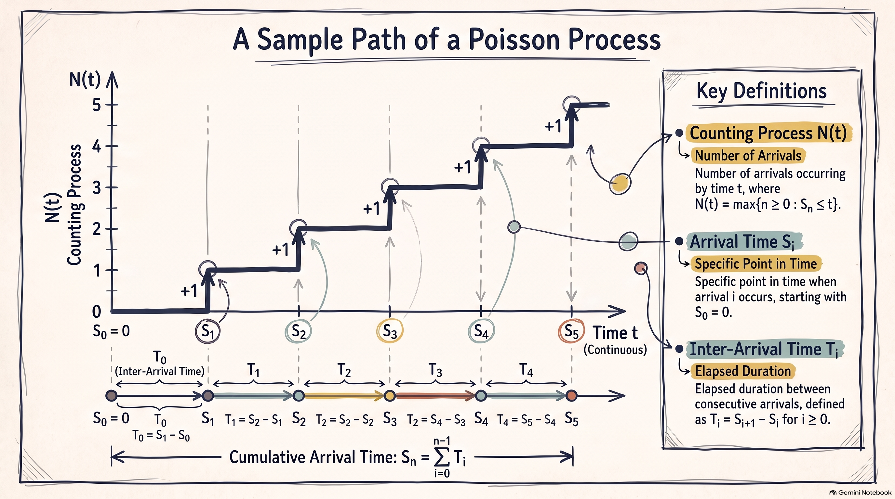
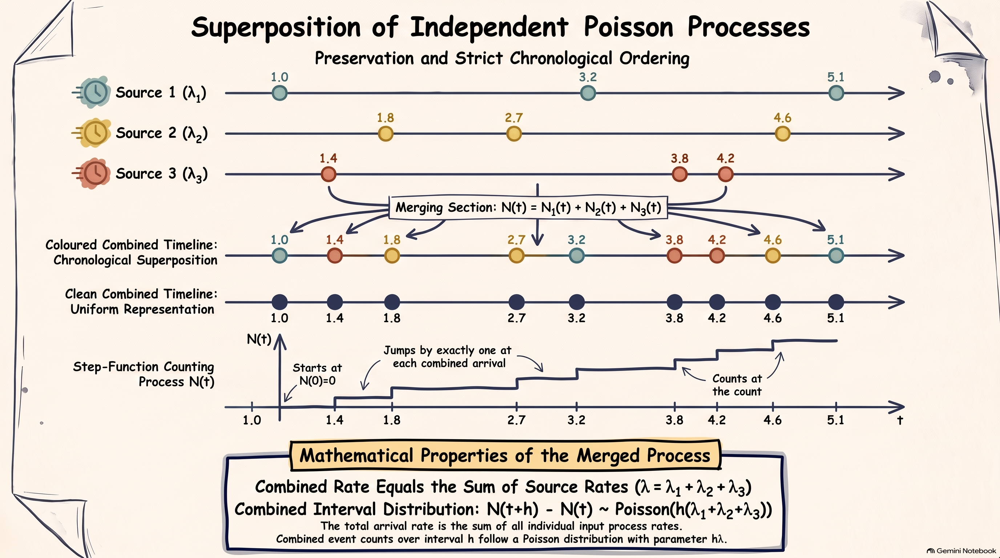
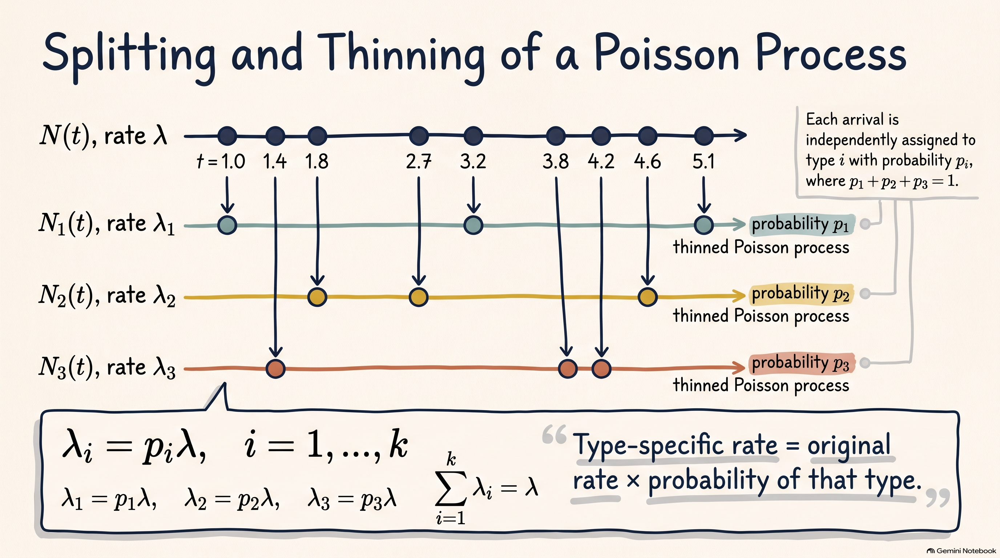

# Introduction to Poisson Processes

## Motivation

Many real-world systems involve events occurring over time. Examples include insurance claims, customer arrivals, and financial transactions.

In previous chapters, we studied Markov chains, which describe systems that evolve through a sequence of discrete time steps. We now consider stochastic processes in which events can occur at any time in a continuous time interval.

Poisson processes provide a mathematical model for counting such events and studying when they occur.

## From Markov Chains to Poisson Processes

A discrete-time Markov chain describes the evolution of a system at times $n=0,1,2,\ldots$. Its future state depends on the current state, given the past.

A Poisson process instead tracks the number of events that have occurred by time $t$, where $t\geq 0$ is continuous.

The distinction is that a Poisson process models event arrivals over continuous time. Although the Poisson process is itself a Markov process, its time parameter is continuous rather than discrete.

## Counting Events over Time

Let $N(t)$ denote the number of events that occur during the time interval $(0,t]$. The collection $\{N(t):t\geq 0\}$ is called a counting process.

The process starts at $N(0)=0$ and is non-decreasing: if $0\leq s\leq t$, then $N(s)\leq N(t)$.

For example, if three claims occur by time $t=5$, then $N(5)=3$. If two more claims occur between times $5$ and $8$, then $N(8)=5$.

## Applications

Poisson processes are used to model event arrivals in many fields.

- **Insurance:** the number of claims reported to an insurer over time.
- **Finance:** the arrival of credit defaults or certain types of financial events.
- **Telecommunications:** the number of calls received by a call centre.
- **Transportation:** the number of accidents occurring on a highway.
- **Healthcare:** the number of patients arriving at an emergency department.

The suitability of the model depends on whether its assumptions reasonably describe the event-generating mechanism.

## Questions of Interest

Suppose insurance claims arrive at an average rate of $\lambda=20$ claims per day.

We may ask:

- What is the probability that more than 100 claims arrive during a seven-day period?
- What is the expected waiting time until the next claim?
- What is the probability that no claims occur during the next two hours?

A Poisson process provides a framework for answering these questions by modelling both the number of events and the time between successive events.

## Assumptions Underlying the Poisson Process

A homogeneous Poisson process with rate $\lambda>0$ is based on the following assumptions.

- **Independent increments:** the numbers of events occurring in disjoint time intervals are independent.
- **Stationary increments:** the distribution of the number of events in an interval depends only on the interval's length, not on its starting time.
- **Constant rate:** the expected number of events in an interval of length $t$ is $\lambda t$.
- **Negligible probability of multiple events in a very short interval:** over a small interval of length $h$, the probability of two or more events is of smaller order than $h$.

The parameter $\lambda$ is the average number of events per unit time. It must be measured using a consistent time unit.

These assumptions lead to the Poisson distribution for event counts and the exponential distribution for interarrival times, which will be developed in the following sections.


# The Poisson Process

## Definition and Notation

A Poisson process is a counting process $\{N(t):t\geq 0\}$ that models the number of events occurring over time.

- $N(0)=0$, and $N(t)$ is a non-negative integer.
- $N(t)$ is non-decreasing and has a right-continuous step-function sample path.
- For $0\leq s<t$, the number of events in $(s,t]$ is $N(t)-N(s)$.

A homogeneous Poisson process with rate $\lambda>0$ has independent increments, stationary increments, and an event rate that is constant over time.

## Homogeneous Poisson Process

A homogeneous Poisson process models the number of events occurring randomly over time at a constant average rate.

Examples include insurance claims, customer arrivals, and equipment failures.

A counting process $\{N(t):t\geq 0\}$ is a homogeneous Poisson process with rate $\lambda>0$ if it satisfies:

- **Initial condition:** $N(0)=0$.
- **Independent increments:** Event counts in disjoint time intervals are independent.
- **Stationary increments:** The distribution of the event count depends only on the interval length.
- **Poisson distribution:** For $s,t\geq 0$,
  $$
  N(s+t)-N(s)\sim\operatorname{Poisson}(\lambda t).
  $$

Here, $\lambda$ is the constant average number of events per unit time.


## The Poisson Distribution of Event Counts

For a homogeneous Poisson process with rate $\lambda$, the number of events during an interval of length $t$ follows a Poisson distribution with parameter $\lambda t$.

$$
N(t)\sim\operatorname{Poisson}(\lambda t).
$$

Hence, for $n=0,1,2,\ldots$,

$$
\Pr(N(t)=n)=
\frac{(\lambda t)^n e^{-\lambda t}}{n!}.
$$

The mean and variance are both $\lambda t$:

$$
\operatorname{E}[N(t)]=\operatorname{Var}[N(t)]=\lambda t.
$$

## The Rate Parameter

The parameter $\lambda$ is the constant event rate, measured as the expected number of events per unit time.

For example, if an insurer receives an average of 20 claims per day, then $\lambda=20$ claims per day. Over a period of $t$ days, the expected number of claims is $20t$.

The rate parameter determines how quickly events occur on average. A larger $\lambda$ means more events are expected over the same time interval.

The rate is an average, not a guarantee that exactly $\lambda t$ events will occur.

## The Probability of No Events

The probability of observing no events during an interval of length $t$ is obtained by setting $n=0$ in the Poisson probability formula.

$$
\Pr(N(t)=0)=e^{-\lambda t}.
$$

By stationary increments, the same result applies to any interval $(s,s+t]$:

$$
\Pr(N(s+t)-N(s)=0)=e^{-\lambda t}.
$$

For example, if claims arrive at a rate of $\lambda=20$ per day, the probability of no claims during the next hour is $e^{-20/24}$, assuming a day contains 24 hours.

The probability of no events decreases as either the event rate or the length of the observation interval increases.


# Definition and Properties of the Poisson Process

## The Poisson Process: Two Approaches

- A Poisson process models the occurrence of events over time, such as insurance claims or equipment failures.
- Let $N(t)$ denote the number of events occurring by time $t$, with $N(0)=0$.
- The process has a constant rate $\lambda>0$, measured in events per unit time.
- There are two complementary ways to define a Poisson process:
  - **Local approach:** Describe the probabilities of events over a very short time interval.
  - **Distributional approach:** Specify the distribution of event counts and the properties of increments.
- Both approaches describe the same homogeneous Poisson process under the appropriate assumptions.

## Definition 1: Local Behaviour

A counting process $\{N(t):t\geq0\}$ is a Poisson process with rate $\lambda>0$ if it has independent increments and, as $h\to0$,

$$
\begin{aligned}
\Pr(N(t+h)-N(t)=1)&=\lambda h+o(h),\\
\Pr(N(t+h)-N(t)=0)&=1-\lambda h+o(h),\\
\Pr(N(t+h)-N(t)\geq2)&=o(h).
\end{aligned}
$$

- The probability of one event in a short interval of length $h$ is approximately $\lambda h$.
- The probability of two or more events is negligible relative to $h$.
- The notation $o(h)$ means that $o(h)/h\to0$ as $h\to0$.
- Independent increments mean that event counts in disjoint intervals are independent.

## Definition 1: Interpretation

- The rate $\lambda$ is the average number of events per unit time.
- For example, if claims arrive at an average rate of $20$ per day, then $\lambda=20$ claims per day.
- Over a short interval of length $h$ days, the probability of one claim is approximately $20h$.
- The approximation applies when $h$ is sufficiently small.
- The local conditions describe how events occur over short intervals; they do not directly give the distribution of the total number of events over a longer interval.

## Definition 2: Distributional Properties

A counting process $\{N(t):t\geq0\}$ is a homogeneous Poisson process with rate $\lambda>0$ if:

- $N(0)=0$.
- It has independent increments.
- For every $0\leq s<t$,

  $$
  N(t)-N(s)\sim\operatorname{Poisson}(\lambda(t-s)).
  $$

Equivalently,

$$
\Pr(N(t)-N(s)=n)
=\frac{e^{-\lambda(t-s)}[\lambda(t-s)]^n}{n!},
\quad n=0,1,2,\ldots.
$$

- The increment distribution depends only on the interval length $t-s$, so the process has stationary increments.

## Definition 2: Consequences

Taking $s=0$ gives

$$
N(t)\sim\operatorname{Poisson}(\lambda t).
$$

Hence, $\operatorname{E}[N(t)]=\operatorname{Var}(N(t))=\lambda t.$

The probability of no events in an interval of length $t$ is

$$
\Pr(N(t)=0)=e^{-\lambda t}.
$$

The probability of at least one event is

$$
\Pr(N(t)\geq1)=1-e^{-\lambda t}.
$$

These results are useful for calculating event probabilities over specified time intervals.

## How Are the Two Definitions Related?

- Definition 1 describes the local behaviour of the process.
- Definition 2 describes the distribution of event counts over finite intervals.
- Under the usual assumptions for a counting process, Definition 1, together with independent increments and $N(0)=0$, leads to the Poisson distribution in Definition 2.
- Conversely, the Poisson increment distribution implies the local probability conditions in Definition 1.

For example, if $N(t)$ is a homogeneous Poisson process, then

$$
\begin{aligned}
\Pr(N(t+h)-N(t)=1)
&=e^{-\lambda h}\lambda h\\
&=\lambda h+o(h).
\end{aligned}
$$

Thus, the two approaches describe the same process, but emphasise different properties.

## Which Definition Should We Use?

- **Definition 1** explains the assumptions about event occurrences over short time intervals.
- **Definition 2** is more convenient for calculating probabilities and deriving moments.
- Both are useful: the local approach motivates the model, while the distributional approach supports most subsequent calculations.
- In the following section, we use the Poisson process to study the times between successive events.


## Worked Example 1: Distribution of a Poisson Process

Show that $N(t)$ has a Poisson distribution with mean $\lambda t$, i.e. $N(t)\sim\operatorname{Poisson}(\lambda t)$.

## Solution: Worked Example 1


## Worked Example 2: Machinery Failures

Machinery failures at a factory occur according to a Poisson process with a rate of one failure every eight hours. Calculate the probability of one or more failures during a given hour.

## Solution: Worked Example 2


## Worked Example 3: Customer Arrivals

Customers arrive at a coffee shop according to a Poisson process with a rate of 10 customers per hour, starting at 9 a.m.

1. Calculate the probability that more than 30 customers arrive between 11 a.m. and 1 p.m.
2. Calculate the probability that exactly 30 customers have arrived by noon and exactly 50 by 2 p.m.

## Solution: Worked Example 3


## Worked Example 4: Independent Increments

Let $N(t)$ be a Poisson process with rate $\lambda=5$ events per hour.

1. Find the probability that exactly 3 events occur between 10 a.m. and 11 a.m.
2. Find the probability that exactly 3 events occur between 10 a.m. and 11 a.m. and exactly 4 events occur between 11 a.m. and noon.

## Solution: Worked Example 4


## Worked Example 5: Conditional Probability

Customers arrive at a service counter according to a Poisson process with rate $\lambda=12$ customers per hour.

Given that 5 customers arrive during a one-hour period, find the probability that exactly 2 customers arrive during the first 30 minutes.

## Solution: Worked Example 5


# Inter-Arrival Times

## Why Study Inter-Arrival Times?

A Poisson process describes the number of events occurring over time. We can study the process through the time between successive events.

- Instead of generating the number of arrivals directly, we can generate the waiting time until each arrival.
- The inter-arrival times provide a simple way to simulate a sample path of a Poisson process.
- Their probability distributions allow us to calculate the waiting time until the first arrival and the time of the $n$-th arrival.
- For a Poisson process, the inter-arrival times are independent and exponentially distributed.

This gives an alternative description of a Poisson process and connects the counting process to the exponential and gamma distributions.

## Definition of Inter-Arrival Times

Let $T_0$ denote the time from $0$ to the first arrival, and let $T_i$ denote the time between the $i$-th and $(i+1)$-th arrivals for $i\geq 1$.

Define the successive arrival times by

$$
S_0=0,\qquad S_n=\sum_{i=0}^{n-1}T_i,\quad n\geq 1.
$$

Then $S_n$ is the time of the $n$-th arrival, and

$$
N(t)=\max\{n\geq 0:S_n\leq t\}.
$$

The sample path is a right-continuous step function that increases by one at each arrival time.


## Poisson Process Sample Path


{width=75% fig-align="center"}


## Simulating a Sample Path

A Poisson process can be simulated by generating successive inter-arrival times and adding them to obtain the arrival times.

- Let $T_i$ be the time between the $i$-th and $(i+1)$-th arrivals, with $T_0$ denoting the time until the first arrival.
- Generate independent inter-arrival times from an exponential distribution with rate $\lambda$.
- Obtain the arrival times by taking cumulative sums.
- The counting process $N(t)$ increases by one at each arrival and remains constant between arrivals.

## Simulating a Sample Path


```{r}
#| fig-width: 6
#| fig-height: 3.5
#| fig-cap: "A simulated sample path of a Poisson process"

set.seed(888)

lambda <- 12
T_length <- 1

# Generate arrival times
arrival_time <- numeric()
last_arrival <- 0

while (last_arrival < T_length) {
  inter_arrival <- rexp(1, rate = lambda)
  last_arrival <- last_arrival + inter_arrival

  if (last_arrival < T_length) {
    arrival_time <- c(arrival_time, last_arrival)
  }
}

# Plot the right-continuous sample path
n <- length(arrival_time)

plot(NA, xlim = c(0, T_length), ylim = c(0, n + 1),
     xlab = "Time t", ylab = "N(t)", yaxt = "n")

# Add a custom y-axis (side = 2 specifies the left side)
axis(2, at = 0:n)

previous_time <- 0
count <- 0

for (t in arrival_time) {
  # 1. Draw a solid black dot at the start (left) of the horizontal segment
  points(previous_time, count, pch = 16, col = "black")
  
  # 2. Draw your horizontal and vertical segments
  segments(previous_time, count, t, count)
  #segments(t, count, t, count + 1)
  
  # Update state for the next iteration
  previous_time <- t
  count <- count + 1
}

points(previous_time, count, pch = 16, col = "black")
segments(previous_time, count, T_length, count)
```


## Simulating a Sample Path: Set Up the Simulation

```r
set.seed(888)

lambda <- 12
T_length <- 1

# Generate arrival times
arrival_time <- numeric()
last_arrival <- 0
```

- `lambda` is the arrival rate per unit time.
- `T_length` is the length of the observation interval.
- `arrival_time` stores the arrival times, while `last_arrival` records the most recent arrival time.

## Simulating a Sample Path: Generate Arrival Times

Generate independent exponential inter-arrival times and accumulate them to obtain the arrival times.

```r
while (last_arrival < T_length) {
  inter_arrival <- rexp(1, rate = lambda)
  last_arrival <- last_arrival + inter_arrival

  if (last_arrival < T_length) {
    arrival_time <- c(arrival_time, last_arrival)
  }
}
```

- Each inter-arrival time follows an exponential distribution with rate `lambda`.
- Only arrivals occurring before `T_length` are recorded.
- The loop stops when the next arrival occurs at or beyond the observation horizon.

## Simulating a Sample Path: Set Up the Plot

```r
n <- length(arrival_time)

plot(NA, xlim = c(0, T_length), ylim = c(0, n + 1),
     xlab = "Time t", ylab = "N(t)", yaxt = "n")

axis(2, at = 0:n)
```

- Set the horizontal axis to the observation interval and the vertical axis to the possible count values.
- `axis(2, at = 0:n)` displays integer values on the vertical axis.

## Simulating a Sample Path: Draw the Jumps

```r
previous_time <- 0
count <- 0

for (t in arrival_time) {
  points(previous_time, count, pch = 16, col = "black")
  segments(previous_time, count, t, count)
  previous_time <- t
  count <- count + 1
}
points(previous_time, count, pch = 16, col = "black")
segments(previous_time, count, T_length, count)
```

- The horizontal segments show that $N(t)$ remains constant between arrivals.
- At each arrival time, the process jumps upward by one.
- The resulting sample path is a right-continuous step function.


## The Exponential Distribution

For a Poisson process with rate $\lambda>0$, the event $T_0>t$ means that no arrivals occur during $[0,t]$.

Therefore,

$$
\begin{aligned}
\Pr(T_0>t)
&=\Pr(N(t)=0)\\
&=e^{-\lambda t},\qquad t\geq 0.
\end{aligned}
$$

Hence, $T_0$ has an exponential distribution with rate $\lambda$:

$$
T_0\sim\operatorname{Exp}(\lambda).
$$

Its density and mean are

$$
f_{T_0}(t)=\lambda e^{-\lambda t},
\quad t\geq 0,
\qquad
\operatorname{E}[T_0]=\frac{1}{\lambda}.
$$

The parameter $\lambda$ is the expected number of arrivals per unit time. Thus, the mean waiting time between arrivals is $1/\lambda$.

## Independence of Inter-Arrival Times

The independent-increments property implies that the waiting time after an arrival is independent of the history before that arrival.

For a Poisson process, the successive inter-arrival times are independent and identically distributed:

$$
T_0,T_1,T_2,\ldots
\overset{\text{i.i.d.}}{\sim}
\operatorname{Exp}(\lambda).
$$

In particular, for $s,t\geq 0$,

$$
\begin{aligned}
\Pr(T_0>s,T_1>t)
&=e^{-\lambda s}e^{-\lambda t}\\
&=\Pr(T_0>s)\Pr(T_1>t).
\end{aligned}
$$

This factorisation illustrates the independence of the first two inter-arrival times. The same property holds for every finite collection of successive inter-arrival times.

## Arrival Times and Their Distributions

The time of the $n$-th arrival is the sum of the first $n$ inter-arrival times:

$$
S_n=T_0+T_1+\cdots+T_{n-1}.
$$

Since the inter-arrival times are independent exponential random variables with rate $\lambda$,

$$
S_n\sim\operatorname{Gamma}(n,\text{ rate }\lambda),
\qquad n\geq 1.
$$

Its density is

$$
f_{S_n}(t)
=\frac{\lambda^n t^{n-1}e^{-\lambda t}}{(n-1)!},
\qquad t\geq 0.
$$

The event $S_n\leq t$ is equivalent to having at least $n$ arrivals by time $t$. Hence,

$$
\Pr(S_n\leq t)=\Pr(N(t)\geq n).
$$

Using the Poisson distribution,

$$
\Pr(S_n\leq t)
=1-\sum_{k=0}^{n-1}
\frac{(\lambda t)^k e^{-\lambda t}}{k!}.
$$

This connects the distribution of arrival times to the distribution of the number of arrivals.

## Summary

- Inter-arrival times are independent and exponentially distributed with rate $\lambda$.
- The mean inter-arrival time is $1/\lambda$.
- The $n$-th arrival time is the sum of $n$ independent exponential random variables and has a gamma distribution.
- The number of arrivals by time $t$ has a Poisson distribution with mean $\lambda t$.
- These results allow us to simulate sample paths and calculate probabilities involving arrival times.


## Worked Example 6: Inter-Arrival Times

For a Poisson process with rate $\lambda$, the inter-arrival times $\{T_i\}_{i\geq 0}$ are independent and identically distributed exponential random variables with rate $\lambda$.

Suppose events occur according to a Poisson process with rate $\lambda=3$ per hour.

1. State the distribution of the inter-arrival times.
2. Calculate the expected time between successive events.
3. Calculate the probability that the time between two successive events exceeds 30 minutes.

## Solution: Worked Example 6


## Worked Example 7: Equipment Failures

In Worked Example 2, equipment malfunctions are modelled by a Poisson process with rate $1/8$ failures per hour.

Calculate the probability that the second failure occurs within one hour of the first failure.

## Solution: Worked Example 7


## Worked Example 8: Insurance Claims

Insurance claims arrive according to a Poisson process with rate 5 claims per day.

1. Calculate the probability that at least two claims are reported on a given day.
2. Calculate the probability that another claim is reported within the next hour after a claim has just been reported.
3. Calculate the expected time until the next claim, given that no claims have been reported during the previous two days.

## Solution: Worked Example 8


## Worked Example 9: Time Until the Second Arrival

Customers arrive at a service centre according to a Poisson process with rate 4 customers per hour.

1. State the distribution of the time until the second customer arrives.
2. Calculate the probability that the second customer arrives within 30 minutes of the start of observation.
3. Calculate the expected time until the second customer arrives.

## Solution: Worked Example 9


## Worked Example 10: Inter-Arrival Times and Arrival Times

Claims arrive according to a Poisson process with rate 2 claims per day.

1. Calculate the probability that the time between successive claims exceeds half a day.
2. Calculate the probability that the third claim arrives within two days of the start of observation.
3. Calculate the expected time until the third claim arrives.


## Solution: Worked Example 10


The solution to this example will be provided later in the section on **Conditional Distributions**.


# Properties of the Poisson Process

## Why Study the Properties?

Poisson processes are useful for modelling events that occur randomly over time, such as insurance claims, equipment failures, and customer arrivals.

Their properties allow us to answer questions about event counts without modelling every arrival time individually.

- **Independent increments:** Future counts over a new interval are independent of counts over earlier intervals.
- **Stationary increments:** The distribution of the number of events depends on the interval length, not its starting time.
- **Memorylessness:** The remaining waiting time has the same distribution as a fresh waiting time.
- **Superposition:** Independent arrival streams can be combined into one Poisson process.
- **Thinning:** A Poisson process can be divided into independent processes according to event types.

## Independent Increments

Suppose insurance claims follow a Poisson process with rate $\lambda$ claims per day.

The numbers of claims occurring during disjoint time intervals are independent.

For $0 \leq s < t \leq u < v$, the increments $N(t)-N(s)$ and $N(v)-N(u)$ are independent.

For example, the number of claims on Monday is independent of the number of claims on Tuesday.

More generally, counts over any collection of disjoint time intervals are mutually independent.

This property allows us to calculate probabilities for different periods separately.

## Stationary Increments

The distribution of the number of events in an interval depends only on its length.

For a Poisson process with rate $\lambda$,

$$
N(t+h)-N(t)\sim \operatorname{Poisson}(\lambda h).
$$

Hence,

$$
\Pr(N(t+h)-N(t)=n)
=\frac{e^{-\lambda h}(\lambda h)^n}{n!},
$$

for $n=0,1,2,\ldots$.

The expected number of events is $\lambda h$, regardless of the starting time $t$.

For example, if claims arrive at a constant rate of 4 per day, the number of claims in any one-day interval has a Poisson distribution with mean 4.

## The Memoryless Property

Suppose buses arrive according to a Poisson process with rate $\lambda$ per minute.

The waiting time $X$ until the next bus has an exponential distribution:

$$
X\sim\operatorname{Exponential}(\lambda).
$$

Its survival function is $\Pr(X>t)=e^{-\lambda t}$.

The memoryless property states that, for $s,t\geq 0$,

$$
\Pr(X>s+t\mid X>s)=\Pr(X>t).
$$

Therefore, conditional on having waited $s$ minutes without a bus arriving, the remaining waiting time has the same exponential distribution as the original waiting time.

The process does not become more or less likely to produce an arrival simply because no arrival has occurred recently.

## Why Memorylessness Matters

Suppose buses arrive, on average, once every 30 minutes. The interarrival times are exponentially distributed with rate $\lambda=1/30$ per minute.

If no bus has arrived during the first 10 minutes, the probability of waiting at least another 20 minutes is

$$
\begin{aligned}
\Pr(X>30\mid X>10)
&=\frac{\Pr(X>30)}{\Pr(X>10)}\\
&=\frac{e^{-30/30}}{e^{-10/30}}\\
&=e^{-20/30}.
\end{aligned}
$$

This is exactly the probability that a new waiting time exceeds 20 minutes.

The memoryless property is specific to the exponential distribution among continuous distributions. It is also a key reason exponential interarrival times are used in Poisson process models.


## Worked Example 11: Time Spent at a Dentist's Office

Assume that the amount of time a patient spends in a dentist's office follows an exponential distribution with a mean of 40 minutes.

1. Calculate the probability that a patient spends more than 60 minutes in the dentist's office.

2. Calculate the probability that a patient spends more than 60 minutes in the dentist's office, given that she has already spent 40 minutes there.

## Solution: Worked Example 11

## Superposition of Independent Poisson Processes

Consider several independent sources of arrivals, each modelled by a Poisson process.

Examples include claims from different insurance portfolios, customer arrivals at different entrances, or failures from different types of equipment.

Let $N_1(t),\ldots,N_k(t)$ be independent Poisson processes with rates $\lambda_1,\ldots,\lambda_k$.

The combined process is

$$
N(t)=\sum_{i=1}^{k}N_i(t).
$$

## Superposition: Combined Arrival Rate

By the superposition property, $N(t)$ is a Poisson process with rate

$$
\lambda=\sum_{i=1}^{k}\lambda_i.
$$

For any interval of length $h$,

$$
N(t+h)-N(t)\sim
\operatorname{Poisson}\left(h\sum_{i=1}^{k}\lambda_i\right).
$$

The combined arrival rate is the sum of the individual rates. This allows us to model arrivals from several independent sources as a single Poisson process.


## Superposition Roadmap


{width=75% fig-align="center"}


## Identifying the Source of an Arrival

Suppose independent Poisson processes with rates $\lambda_1,\ldots,\lambda_k$ are combined into a single process with rate $\lambda=\sum_{i=1}^k\lambda_i$.

Given an arrival in the combined process, the probability that it comes from source $i$ is

$$
p_i=\frac{\lambda_i}{\lambda}.
$$

The source of each arrival can therefore be viewed as an independent categorical outcome with probabilities $p_1,\ldots,p_k$.

For two sources with rates 2 and 6 per day, the combined rate is 8 per day. Each arrival has probability $2/8=1/4$ of coming from the first source and probability $6/8=3/4$ of coming from the second.

## Identifying the Source of an Arrival

\begin{block}{Note}
The source of each arrival can be modelled by a discrete random variable $X$, where $X=i$ indicates that the arrival comes from source $i$. Its probability mass function is

$$
P(X=i)=p_i,\qquad i=1,\ldots,k.
$$
\end{block}


## Splitting and Thinning of a Poisson Process

Suppose arrivals follow a Poisson process with rate $\lambda$. Each arrival is independently assigned to one of $k$ types, with probabilities $p_1,\ldots,p_k$, where $\sum_{i=1}^k p_i=1$.

Let $N_i(t)$ count the type $i$ arrivals by time $t$.

The splitting (or sampling) property states that $N_1(t),\ldots,N_k(t)$ are independent Poisson processes with respective rates

$$
\lambda_i=p_i\lambda,\qquad i=1,\ldots,k.
$$

Each resulting process is called a *thinned Poisson process*.

The rate of each type is the original rate multiplied by the probability of belonging to that type.

## Splitting and Thinning Roadmap


{width=75% fig-align="center"}


## Why Thinning Matters in Insurance

An insurer may be interested in only some of its claims, such as claims exceeding a specified threshold.

Suppose claims arrive at rate $\lambda$ and each claim independently meets the threshold with probability $p$.

The claims meeting the threshold form a Poisson process with rate

$$
\lambda_{\text{selected}}=p\lambda.
$$

This allows us to model large claims directly without first modelling all claims and then identifying which ones are large.

For independent portfolios, thinning can be applied to each portfolio separately, and superposition can then combine the selected claims.

## Worked Example 12: Claims Above a Threshold

An insurer has two independent portfolios, A and B.

- Claims from A arrive at rate 4 per day. Each claim has probability $2/5$ of being at least 5,000 THB.
- Claims from B arrive at rate 6 per day. Each claim has probability $1/3$ of being at least 5,000 THB.

Calculate the expected number of claims of at least 5,000 THB during the next day.


## Solution: Worked Example 12


<!-- By thinning, the rates of qualifying claims from A and B are -->

<!-- $$ -->
<!-- \lambda_A=4\left(\frac25\right)=\frac85, -->
<!-- \qquad -->
<!-- \lambda_B=6\left(\frac13\right)=2. -->
<!-- $$ -->

<!-- ## Worked Example: Claims Above a Threshold -->


<!-- By superposition, the combined rate is -->

<!-- $$ -->
<!-- \lambda=\frac85+2=\frac{18}{5}. -->
<!-- $$ -->

<!-- The expected number of qualifying claims during the next day is therefore $\frac{18}{5}=3.6$. -->

## Worked Example 13: Claims from Two Groups

Claims from male policyholders and female policyholders arrive independently according to Poisson processes with rates 2 and 6 per day, respectively.

1. Calculate the probabilities of no claims and at least two claims during a given week.
2. Calculate the probability that four claims from female policyholders occur before the second claim from a male policyholder.

## Solution: Worked Example 13

<!-- By superposition, the total claim process has rate -->

<!-- $$ -->
<!-- \lambda=2+6=8\text{ claims per day}. -->
<!-- $$ -->

<!-- Each claim is from a male policyholder with probability $1/4$ and from a female policyholder with probability $3/4$. -->

<!-- **1. Claims during one week** -->

<!-- The total number of claims in seven days has distribution $N\sim\operatorname{Poisson}(56)$. -->

<!-- Hence, $\Pr(N=0)=e^{-56},$ -->

<!-- and $\Pr(N\geq 2)=1-\Pr(N=0)-\Pr(N=1)=1-57e^{-56}.$ -->

<!-- Both probabilities are extremely close to 0 and 1, respectively. -->

<!-- ## Worked Example: Solution -->
<!-- **2. Four female claims before the second male claim** -->

<!-- The required event occurs if at least four of the first five claims are from female policyholders. -->

<!-- Let $Y$ be the number of female claims among the first five claims. Then $Y\sim\operatorname{Binomial}(5,3/4)$. -->

<!-- Therefore, -->

<!-- $$ -->
<!-- \begin{aligned} -->
<!-- \Pr(Y\geq 4) -->
<!-- &=\binom54\left(\frac34\right)^4\left(\frac14\right) -->
<!-- +\left(\frac34\right)^5\\ -->
<!-- &=0.6328125. -->
<!-- \end{aligned} -->
<!-- $$ -->

## Summary

The properties of a Poisson process provide several useful modelling tools.

- Independent and stationary increments describe counts over disjoint intervals.
- The memoryless property explains why exponential waiting times are appropriate for Poisson arrivals.
- Superposition combines independent arrival streams by adding their rates.
- Thinning selects events by independent classification and multiplies the rate by the selection probability.

Together, these properties simplify calculations involving arrivals from multiple sources, selected event types, and waiting times.


<!-- # Conditional Distributions -->

<!-- ## Event Times Given the Total Number of Events -->

<!-- Consider a Poisson process $\{N(t):t\geq 0\}$ with rate $\lambda$. -->

<!-- Given that $N(T)=n$, the $n$ event times are distributed as the order statistics of $n$ independent Uniform$(0,T)$ random variables. -->

<!-- - The event times are uniformly distributed over $(0,T)$ before ordering. -->
<!-- - The conditional distribution of the event times does not depend on $\lambda$. -->

<!-- ## Uniform Distribution of Event Times -->

<!-- Given $N(T)=n$, let $T_1<T_2<\cdots<T_n$ denote the ordered event times. -->

<!-- The joint probability density function is -->

<!-- $$ -->
<!-- f_{T_1,\ldots,T_n}(t_1,\ldots,t_n\mid N(T)=n) -->
<!-- =\frac{n!}{T^n}, -->
<!-- $$ -->

<!-- for $0<t_1<\cdots<t_n<T$. -->

<!-- For example, conditional on $N(1)=5$, the five event times are distributed as the order statistics of five independent Uniform$(0,1)$ random variables. -->

<!-- ## Conditional Distributions of Event Counts -->

<!-- Suppose $0<s<T$. Given that $N(T)=n$, the number of events during the first $s$ time units has a binomial distribution: -->

<!-- $$ -->
<!-- N(s)\mid N(T)=n -->
<!-- \sim \operatorname{Bin}\left(n,\frac{s}{T}\right). -->
<!-- $$ -->

<!-- Hence, -->

<!-- $$ -->
<!-- \Pr(N(s)=k\mid N(T)=n) -->
<!-- =\binom{n}{k} -->
<!-- \left(\frac{s}{T}\right)^k -->
<!-- \left(1-\frac{s}{T}\right)^{n-k}. -->
<!-- $$ -->

<!-- The probability depends on the proportion of the observation period, rather than the Poisson rate $\lambda$. -->

<!-- ## Worked Example: Customer Arrivals -->

<!-- Customers arrive at a service counter according to a Poisson process with rate $\lambda=12$ customers per hour. -->

<!-- Given that 5 customers arrive during a one-hour period, find the probability that exactly 2 customers arrive during the first 30 minutes. -->

<!-- ## Solution: Customer Arrivals -->

<!-- Let $N(t)$ denote the number of arrivals during the first $t$ hours. -->

<!-- Given $N(1)=5$, -->

<!-- $$ -->
<!-- N(0.5)\mid N(1)=5 -->
<!-- \sim \operatorname{Bin}(5,0.5). -->
<!-- $$ -->

<!-- Therefore, -->

<!-- $$ -->
<!-- \begin{aligned} -->
<!-- &\Pr(N(0.5)=2\mid N(1)=5)\\ -->
<!-- &\quad=\binom{5}{2}(0.5)^2(0.5)^3\\ -->
<!-- &\quad=\frac{10}{32}=0.3125. -->
<!-- \end{aligned} -->
<!-- $$ -->

<!-- The required probability is $0.3125$. -->

<!-- ## Worked Example: Insurance Claims -->

<!-- Claims arrive at an insurance company according to a Poisson process with rate $\lambda=8$ claims per day. -->

<!-- Given that 6 claims occur during a 24-hour period, find the probability that exactly 4 claims occur during the first 16 hours. -->

<!-- ## Solution: Insurance Claims -->

<!-- Let $N(t)$ denote the number of claims during the first $t$ hours. -->

<!-- Given $N(24)=6$, -->

<!-- $$ -->
<!-- N(16)\mid N(24)=6 -->
<!-- \sim \operatorname{Bin}\left(6,\frac{16}{24}\right). -->
<!-- $$ -->

<!-- Therefore, -->

<!-- $$ -->
<!-- \begin{aligned} -->
<!-- &\Pr(N(16)=4\mid N(24)=6)\\ -->
<!-- &\quad=\binom{6}{4} -->
<!-- \left(\frac{2}{3}\right)^4 -->
<!-- \left(\frac{1}{3}\right)^2\\ -->
<!-- &\quad=\frac{240}{729}\approx 0.3292. -->
<!-- \end{aligned} -->
<!-- $$ -->

<!-- The required probability is approximately $0.3292$. -->