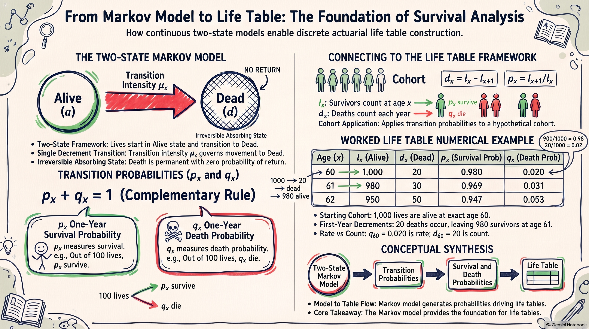
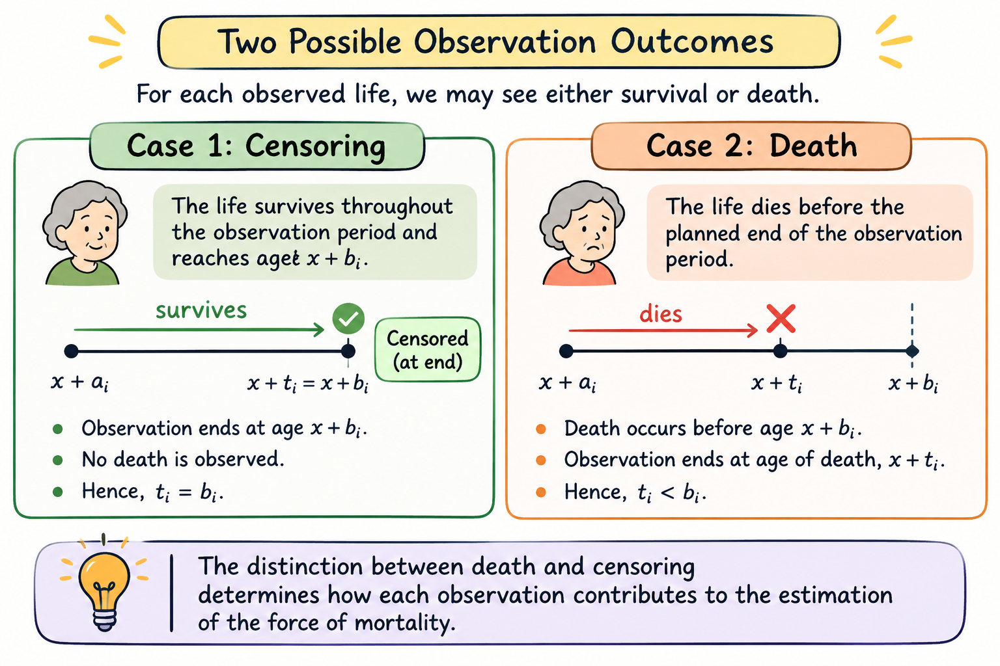

# Introduction and Motivation

## Modelling Human Lifetime

The length of an individual's lifetime is uncertain. In actuarial science, modelling this uncertainty is important for understanding mortality and assessing the financial obligations associated with human life.

Life insurance companies and pension providers need to estimate how long individuals are likely to live. These estimates are used in pricing insurance policies, calculating life insurance benefits, and valuing pension liabilities.

Mathematical models provide a framework for describing and analysing the uncertainty surrounding human lifetime.

## A Life Insurance Problem

Consider a life insurance company that issues a policy to a person currently aged $x$.

To assess the policy, the insurer needs to understand the uncertainty surrounding the policyholder's future lifetime. In particular, the insurer may want to know:

- What is the probability that the policyholder survives for at least another $t$ years?
- What is the probability that the policyholder dies within the next $t$ years?

Let $T_x$ denote the future lifetime of a person aged $x$. It is a continuous random variable representing the time from the current age until death.

The probabilities of interest are therefore

$$
P(T_x>t)
\quad\text{and}\quad
P(T_x\leq t).
$$

## From Future Lifetime to a State-Based Model

Instead of describing an individual's lifetime only through the time until death, we can represent their status using a sequence of states.

Consider a simple model with two possible states:

1. **Alive:** The individual is alive.
2. **Dead:** The individual has died.

The individual starts in the Alive state and eventually moves to the Dead state. Once death occurs, the individual remains in the Dead state.

This representation provides a framework for modelling human lifetime using a two-state Markov model.

## Markov Model to Life Table

{width=75% fig-align="center"}

<!-- ## A Life Insurance Problem -->

<!-- Consider a life insurance company that issues a policy to a person currently aged $x$. -->

<!-- To assess the policy, the insurer needs to understand the likelihood that the policyholder will survive or die over the coming years. -->

<!-- For example, the insurer may want to answer the following questions: -->

<!-- - What is the probability that the policyholder survives for at least another $t$ years? -->
<!-- - What is the probability that the policyholder dies within the next $t$ years? -->
<!-- - How do these probabilities change as the policyholder gets older? -->

<!-- These questions involve uncertainty about the individual's future lifetime. -->

<!-- ## Modelling Human Lifetime -->

<!-- In life insurance, an insurer needs to assess the uncertainty surrounding an individual's future lifetime. -->

<!-- For a person currently aged $x$, we may be interested in questions such as: -->

<!-- - What is the probability that the person survives for at least another $t$ years? -->
<!-- - What is the probability that the person dies within the next $t$ years? -->

<!-- Let $T_x$ denote the future lifetime of a person aged $x$. It is a continuous random variable representing the time until death. -->

<!-- The probabilities of interest can be expressed as -->

<!-- $$ -->
<!-- P(T_x>t) -->
<!-- \quad\text{and}\quad -->
<!-- P(T_x\leq t). -->
<!-- $$ -->

<!-- ## From Survival Models to Markov Models -->

<!-- Instead of describing an individual's lifetime only through the time until death, we can represent their status using a sequence of states. -->

<!-- Consider a simple model with two possible states: -->

<!-- 1. **Alive:** The individual is alive. -->
<!-- 2. **Dead:** The individual has died. -->

<!-- The individual starts in the Alive state and eventually moves to the Dead state. Once death occurs, the individual remains in the Dead state. -->

<!-- This provides a two-state representation of human lifetime, which forms the basis of the Markov model developed in this chapter. -->

<!-- ## Modelling Human Lifetime -->

<!-- Let $T_x$ denote the future lifetime of a person aged $x$. -->

<!-- - $T_x$ is a continuous random variable representing the time until death. -->
<!-- - The probability that the person survives for at least another $t$ years is $P(T_x>t)$. -->
<!-- - The probability that the person dies within the next $t$ years is $P(T_x\leq t)$. -->

<!-- We can study these probabilities by modelling the individual's movement between two possible states: -->

<!-- - **Alive:** The individual is alive. -->
<!-- - **Dead:** The individual has died. -->

<!-- This leads to a two-state Markov model for human lifetime. -->

<!-- ## Modelling Human Lifetime -->

<!-- In life insurance, we are interested in the uncertain future lifetime of an individual. -->

<!-- - Let $T_x$ denote the future lifetime of a person aged $x$. -->
<!-- - $T_x$ is a continuous random variable representing the time until death. -->

<!-- For example, the probability that a person aged $x$ survives for at least another $t$ years is -->

<!-- $$ -->
<!-- P(T_x>t). -->
<!-- $$ -->

<!-- We can study this survival process by modelling the individual's movement between different states. -->

<!-- ## From Survival Models to Markov Models -->

<!-- Instead of focusing only on the time until death, we can describe an individual's lifetime through a sequence of states. -->

<!-- Consider a simple model with two possible states: -->

<!-- 1. **Alive:** The individual is alive. -->
<!-- 2. **Dead:** The individual has died. -->

<!-- The individual starts in the Alive state and eventually moves to the Dead state. Once death occurs, the individual remains in the Dead state. -->

<!-- This gives a simple Markov model of mortality. -->

# The Two-State Markov Model

## The Two-State Model of a Single Decrement

The two-state Markov model describes the movement of an individual between two states:

- State $a$: Alive.
- State $d$: Dead.

The only possible transition is from Alive to Dead.

- Death is an irreversible transition.
- The Dead state is an absorbing state.
- The model is called a **single-decrement model** because there is only one possible type of transition out of the Alive state.

## Transition Diagram

The movement between the two states can be represented by the following transition diagram.

$$
\boxed{\text{Alive }(a)}
\quad\xrightarrow{\ \mu_x\ }\quad
\boxed{\text{Dead }(d)}
$$

Here, $\mu_x$ denotes the transition intensity from Alive to Dead at age $x$.

The transition is one-way: an individual cannot return to the Alive state after entering the Dead state.

## The Markov Property

The Markov property states that the future development of the process depends on its current state, rather than the sequence of states through which it has passed.

For the two-state mortality model:

- If the individual is dead, they remain dead.
- If the individual is alive, the possibility of death is described by the transition intensity at the current age.
- The transition intensity may vary with the individual's attained age.

Thus, the model is a continuous-time Markov model in which the Dead state is absorbing.

## Extension to Multiple States

The two-state model provides a simple framework for modelling human lifetime using the states Alive and Dead.

However, many actuarial problems involve more than two possible states.

For example, a life insurance model may distinguish between:

- **Healthy:** The individual is alive and in good health.
- **Disabled:** The individual is alive but unable to work.
- **Dead:** The individual has died.

Transitions may occur between these states, depending on the individual's circumstances.

Such models are known as **multi-state models**. We will extend the two-state framework to models with multiple states in the next chapter.

# Transition Probabilities

## Future Lifetime

Let $T_x$ denote the future lifetime of an individual currently aged $x$.

- $T_x$ is a continuous random variable representing the remaining time until death.
- Let $w$ denote the **limiting age**, the maximum possible age of an individual.
- In practice, the limiting age is often taken to be between 100 and 120 years.

The age at death is therefore $x+T_x$.

## Distribution and Survival Functions

The future lifetime $T_x$ can be described using two functions.

**Distribution function**

$$
F_x(t)=P(T_x\leq t).
$$

This is the probability that an individual aged $x$ dies within the next $t$ years.

**Survival function**

$$
S_x(t)=P(T_x>t).
$$

This is the probability that an individual aged $x$ survives for more than another $t$ years.

Since $T_x$ is continuously distributed, $F_x(t)+S_x(t)=1.$

## Actuarial Notation for Transition Probabilities

Actuaries use the following notation to describe the probabilities of transitioning between the Alive and Dead states.

**Probability of death within $t$ years:**

$$
{}_tq_x
= P(T_x\leq t)
= P(T_0\leq x+t\mid T_0>x).
$$

**Probability of survival for at least another $t$ years:**

$$
{}_tp_x
= P(T_x>t)
= P(T_0>x+t\mid T_0>x).
$$

Here, $T_0$ denotes the total lifetime from birth.

These probabilities satisfy

$$
{}_tp_x+{}_tq_x=1.
$$

## Definition of a Transition Probability

The transition probability from one state to another is the probability that an individual is in a particular state at a future time, given their current state.

For the two-state model, the probability that a person aged $x$ is still alive at age $x+t$ is

$$
{}_tp_x
=
P(\text{Alive at age }x+t
\mid
\text{Alive at age }x).
$$

Similarly, the probability that a person aged $x$ is dead by age $x+t$ is

$$
{}_tq_x
=
P(\text{Dead by age }x+t
\mid
\text{Alive at age }x).
$$

## Transition Probability Matrix

The transition probabilities over an interval of length $t$ can be represented by a matrix.

Taking the state order as $(\text{Alive},\text{Dead})$,

$$
P_x(t)=
\begin{pmatrix}
{}_tp_x & {}_tq_x\\
0 & 1
\end{pmatrix}.
$$

- ${}_tp_x$: probability of remaining alive for another $t$ years.
- ${}_tq_x$: probability of moving from Alive to Dead within $t$ years.
- The Dead state is absorbing, so the individual remains dead with probability 1.

## Objective of the Two-State Markov Model

Our objective is to determine the transition probabilities between the Alive and Dead states.

In particular, we would like to calculate

$$
{}_tp_x
=
P(\text{Alive at age }x+t
\mid
\text{Alive at age }x),
$$

the probability that a person currently aged $x$ survives for at least another $t$ years.

Once we know this probability, we can also determine the probability of death within $t$ years using

$$
{}_tq_x=1-{}_tp_x.
$$

**The following sections develop the assumptions and methods needed to calculate these transition probabilities.**

## Why Do We Need the Force of Mortality?

Suppose we compare two individuals, one aged 30 and the other aged 80.

Even if we know the probability that each individual dies within the next year, these probabilities tell us only about the risk over that particular year.

In actuarial modelling, we also want to understand how the risk of death behaves at each age and how it changes as an individual gets older.

This motivates the need for a measure of the **instantaneous rate of death**, which leads to the concept of the force of mortality.

## Force of Mortality

The probability of death over a short time interval depends on the individual's current age.

The **force of mortality**, also called the transition intensity or hazard rate, measures the instantaneous rate of death for an individual who is alive at a given age.

At age $x$, it is defined as

$$
\mu_x
=
\lim_{h\to 0^+}
\frac{1}{h}
P(T_0\leq x+h\mid T_0>x).
$$

Equivalently,

$$
\mu_x
=
\lim_{h\to 0^+}\frac{{}_hq_x}{h}.
$$

The force of mortality is measured per unit of time. Throughout this chapter, we use years as the time unit.

## Transition Probabilities over a Short Interval

For a sufficiently small time interval $h$, the probability of death can be approximated by

$$
{}_hq_x\approx \mu_x h.
$$

Similarly, the probability of remaining alive is approximately

$$
{}_hp_x\approx 1-\mu_xh.
$$

Thus, the probability of death over a short interval is approximately proportional to:

- The length of the time interval, $h$.
- The force of mortality at the current age, $\mu_x$.

## Worked Example: Short-Term Probability of Death

Suppose the force of mortality for a 70-year-old male in Thailand is approximately

$$
\mu_{70}=0.05
$$

per year.

Calculate approximately the probability that he dies within:

1. One day.
2. One week.

## Worked Example: Short-Term Probability of Death

**Solution**

For a short time interval $h$, we use

$$
{}_hq_x\approx \mu_xh.
$$

**(a) Within one day**

Taking $h=1/365$ years,

$$
\begin{aligned}
{}_{\frac{1}{365}}q_{70}
&\approx \frac{1}{365}\times 0.05\\
&\approx 0.000137.
\end{aligned}
$$

**(b) Within one week**

Taking $h=7/365$ years,

$$
\begin{aligned}
{}_{\frac{7}{365}}q_{70}
&\approx \frac{7}{365}\times 0.05\\
&\approx 0.000959.
\end{aligned}
$$

The probability of death increases with the length of the observation interval.

# Assumptions Underlying the Markov Model

## The Markov Assumptions

The two-state Markov model is based on the following assumptions.

1. **Markov assumption:** The future state of an individual depends only on the current age and the state currently occupied, and not on the individual's previous history.

2. **Transition intensity assumption:** For a short time interval of length $dt$, the probability of moving from Alive to Dead is

   $$
   {}_{dt}q_{x+t}
   =\mu_{x+t}\,dt+o(dt),
   \qquad t\geq 0.
   $$

The second assumption states that the probability of death over a sufficiently short interval is approximately proportional to the force of mortality at the current age.

Here, $o(dt)$ denotes a term that approaches zero faster than $dt$ as $dt\to 0$, that is,

$$
\lim_{dt\to 0}\frac{o(dt)}{dt}=0.
$$

## An Equivalent Definition of the Transition Intensity

The second assumption can also be expressed using a limit:

$$
\boxed{
\mu_{x+t}
=
\lim_{dt\to 0^+}
\frac{{}_{dt}q_{x+t}}{dt}
}
$$

This means that the force of mortality at age $x+t$ is the instantaneous rate of death for an individual who is alive at that age.

Thus, the transition intensity is the limiting probability of death per unit of time over an increasingly short interval.

## Deriving the Survival Probability

We now derive the probability that an individual aged $x$ survives for at least another $t$ years, denoted by ${}_tp_x$.

**Worked Example: Derivation of the Survival Probability**

Use the Markov assumptions to show that

$$
{}_tp_x
=
\exp\left(-\int_0^t\mu_{x+s}\,ds\right).
$$

<!-- **Solution** -->

<!-- Consider the probability of surviving from age $x$ to age $x+t+dt$. By conditioning on the individual's state at age $x+t$, we obtain -->

<!-- $$ -->
<!-- \begin{aligned} -->
<!-- {}_{t+dt}p_x -->
<!-- &={}_tp_x\,{}_{{dt}}p_{x+t} -->
<!--   +{}_tq_x\times 0\\ -->
<!-- &={}_tp_x\,{}_{{dt}}p_{x+t}\\ -->
<!-- &={}_tp_x\left(1-{}_{{dt}}q_{x+t}\right). -->
<!-- \end{aligned} -->
<!-- $$ -->

<!-- Using the transition intensity assumption, -->

<!-- $$ -->
<!-- {}_{t+dt}p_x -->
<!-- ={}_tp_x\left(1-\mu_{x+t}\,dt+o(dt)\right). -->
<!-- $$ -->

<!-- Rearranging, -->

<!-- $$ -->
<!-- \frac{{}_{t+dt}p_x-{}_tp_x}{dt} -->
<!-- = -->
<!-- -{}_tp_x\mu_{x+t} -->
<!-- +\frac{{}_tp_x\,o(dt)}{dt}. -->
<!-- $$ -->

<!-- Taking the limit as $dt\to 0$ gives the differential equation -->

<!-- $$ -->
<!-- \frac{d}{dt}{}_tp_x -->
<!-- =-\mu_{x+t}{}_tp_x. -->
<!-- $$ -->

<!-- Since an individual aged $x$ is alive at the starting time, -->

<!-- $$ -->
<!-- {}_0p_x=1. -->
<!-- $$ -->

<!-- Solving this differential equation with the initial condition gives -->

<!-- $$ -->
<!-- \boxed{ -->
<!-- {}_tp_x -->
<!-- = -->
<!-- \exp\left(-\int_0^t\mu_{x+s}\,ds\right). -->
<!-- } -->
<!-- $$ -->

## Deriving the Survival Probability

Consider the probability that an individual aged $x$ survives to age $x+t+dt$.

By conditioning on the individual's state at age $x+t$, we obtain

$$
\begin{aligned}
{}_{t+dt}p_x
&={}_tp_x\,{}_{dt}p_{x+t}
  +{}_tq_x\times 0\\
&={}_tp_x\,{}_{dt}p_{x+t}\\
&={}_tp_x\left(1-{}_{dt}q_{x+t}\right).
\end{aligned}
$$

The second term is zero because an individual who is dead at age $x+t$ cannot survive to age $x+t+dt$.

## Applying the Transition Intensity Assumption

Recall the transition intensity assumption:

$$
{}_{dt}q_{x+t}
=\mu_{x+t}\,dt+o(dt).
$$

Substituting this into the survival probability gives

$$
\begin{aligned}
{}_{t+dt}p_x
&={}_tp_x\left(1-{}_{dt}q_{x+t}\right)\\
&={}_tp_x\left(1-\mu_{x+t}\,dt+o(dt)\right).
\end{aligned}
$$

Rearranging,

$$
\frac{{}_{t+dt}p_x-{}_tp_x}{dt}
=
-{}_tp_x\mu_{x+t}
+\frac{{}_tp_x\,o(dt)}{dt}.
$$

## Obtaining the Differential Equation

Taking the limit as $dt\to 0$, and using

$$
\lim_{dt\to 0}\frac{o(dt)}{dt}=0,
$$

we obtain

$$
\boxed{
\frac{d}{dt}{}_tp_x
=-\mu_{x+t}{}_tp_x.
}
$$

This differential equation describes how the survival probability changes with time.

Since an individual aged $x$ is alive at the starting time, $\boxed{{}_0p_x=1.}$

This is the initial condition.

## Solving the Differential Equation

We have the differential equation

$$
\frac{d}{dt}{}_tp_x
=-\mu_{x+t}{}_tp_x,
\qquad {}_0p_x=1.
$$

Separating the variables,

$$
\frac{d({}_tp_x)}{{}_tp_x}
=-\mu_{x+t}\,dt.
$$

## Solving the Differential Equation

Integrating from $0$ to $t$,

$$
\begin{aligned}
\int_1^{{}_tp_x}\frac{1}{u}\,du
&=-\int_0^t\mu_{x+s}\,ds,\\
\ln({}_tp_x)
&=-\int_0^t\mu_{x+s}\,ds.
\end{aligned}
$$

Therefore, the survival probability is

$$
\boxed{
{}_tp_x
=
\exp\left(-\int_0^t\mu_{x+s}\,ds\right).
}
$$

## Constant Force of Mortality

As a special case, suppose the force of mortality is constant over the interval, so that

$$
\mu_{x+s}=\mu_x,
\qquad 0\leq s\leq t.
$$

Then the survival probability simplifies to

$$
\boxed{{}_tp_x=e^{-\mu_xt}.}
$$

Since ${}_tp_x+{}_tq_x=1$, the probability of death within $t$ years is

$$
\boxed{{}_tq_x=1-e^{-\mu_xt}.}
$$

Thus, under a constant force of mortality, the future lifetime $T_x$ follows an exponential distribution with parameter $\mu_x$.

# Estimation of the Force of Mortality

## Why Is Estimation Required?

The two-state Markov model describes the transition from Alive to Dead through the force of mortality, $\mu_x$.

- The force of mortality is generally unknown and must be estimated from observed mortality data.
- Suppose we observe a sample of $n$ independent lives over a specified age interval.
- The observation period for each life may end either because the life dies or because the observation period ends.

The aim is to use these observations to estimate $\mu_x$.

## Observing a Sample of Lives

Suppose that $n$ independent lives are observed at ages between $x$ and $x+1$.

For life $i$, where $i=1,\ldots,n$, define:

- $x+a_i$: age at which observation begins.
- $x+b_i$: planned age at which observation ends, provided the life survives.
- $x+t_i$: age at which observation actually ends, either through death or censoring.

Here, $0\leq a_i\leq b_i<1$.

The actual observation period therefore begins at age $x+a_i$ and ends at age $x+t_i$.

## Two Possible Observation Outcomes

There are two possible outcomes for each observed life.

**Case 1: The life survives to the end of the observation period.**

- Observation ends at age $x+b_i$.
- The life is censored at the end of the observation period.
- Hence, $t_i=b_i$.

**Case 2: The life dies during the observation period.**

- Death occurs before age $x+b_i$.
- Observation ends at the age of death, $x+t_i$.
- Hence, $t_i<b_i$.

The following diagrams illustrate these two cases.

## Censoring and Death Observation Outcomes

{width=75% fig-align="center"}

## Case 1: Censoring

The life survives throughout the observation period and reaches age $x+b_i$.

$$
\text{Entry at } x+a_i \xrightarrow{\quad \text{Survival } (t_i) \quad} x+t_i = x+b_i \quad \color{red}{\text{(Censored)}}
$$

The observation ends without observing a death.

## Case 2: Death

The life dies before the planned end of the observation period.

$$
\text{Entry at } x+a_i \xrightarrow{\quad \text{Survival } (t_i) \quad} x+t_i < x+b_i \quad \color{red}{\text{(Death)}}
$$

The observation ends at the age of death.

The distinction between death and censoring determines how each observation contributes to the estimation of the force of mortality.

## The Random Variables $D_i$ and $V_i$

The observations on life $i$ can be described by two random variables:

- $D_i$: an indicator of whether life $i$ dies during the observation period.
- $V_i$: the observed waiting time from the beginning of observation until death or censoring.

Their observed values are denoted by $d_i$ and $v_i$, respectively.

Thus,

$$
D_i =
\begin{cases}
1, & \text{if life } i \text{ dies},\\
0, & \text{if life } i \text{ is censored},
\end{cases}
$$

and $V_i=T_i-a_i,$

where $T_i$ denotes the observed stopping age measured relative to age $x$.

The estimation of the transition intensity $\mu_x$ will be based on the joint distribution of $D_i$ and $V_i$.

## Properties of $D_i$ and $V_i$

The random variables $D_i$ and $V_i$ have two important properties.

**1. They are dependent.**

The observed waiting time depends on whether the life dies or is censored.

- If $D_i=0$, the life survives to the end of the observation period, so that $V_i=b_i-a_i$.
- If $D_i=1$, the life dies before the end of the observation period, so that $V_i<b_i-a_i$.

**2. $V_i$ has a mixed distribution.**

The distribution of $V_i$ contains:

- A discrete probability mass at $v_i=b_i-a_i$, corresponding to censoring.
- A continuous probability density for $0<v_i<b_i-a_i$, corresponding to death.

We derive these contributions under a simplifying assumption about the force of mortality.

## Assumption: Constant Force of Mortality

To derive the joint distribution of $D_i$ and $V_i$, assume that the force of mortality is constant over the age interval $[x,x+1)$.

That is,

$$
\mu_{x+t}=\mu,
\qquad 0\leq t<1,
$$

where $\mu$ is an unknown constant.

Under this assumption, the survival probability over an interval of length $v$ is

$$
{}_vp_{x+a_i}
=
\exp\left(-\int_0^v \mu\,ds\right)
=
e^{-\mu v}.
$$

We now derive the contribution to the joint distribution for each possible observation outcome.

## Worked Example: Joint Distribution of $D_i$ and $V_i$

Show that the contribution from the observation on life $i$ can be written as

$$
f_i(d_i,v_i)=e^{-\mu v_i}\mu^{d_i}.
$$

**Solution**

Let

$$
c_i=b_i-a_i
$$

denote the maximum possible observation period for life $i$.

We consider the two possible cases:

1. $D_i=0$: the life survives to the end of the observation period.
2. $D_i=1$: the life dies during the observation period.

## Case 1: The Life Is Censored ($D_i=0$)

If life $i$ survives to the end of the observation period, then

$$
V_i=b_i-a_i.
$$

The probability of observing this outcome is the probability that the life survives from age $x+a_i$ to age $x+b_i$.

Hence,

$$
\begin{aligned}
&\Pr(D_i=0,V_i=b_i-a_i)\\
&\quad={}_{b_i-a_i}p_{x+a_i}\\
&\quad=\exp\left(
-\int_0^{b_i-a_i}\mu_{x+a_i+s}\,ds
\right).
\end{aligned}
$$

## Case 1: The Life Is Censored ($D_i=0$)

Since the force of mortality is constant,

$$
\Pr(D_i=0,V_i=b_i-a_i)
=
e^{-\mu(b_i-a_i)}.
$$

As $v_i=b_i-a_i$ in this case,

$$
\Pr(D_i=0,V_i=v_i)=e^{-\mu v_i}.
$$

## Case 1: Expressing the Contribution in a Common Form

Since $D_i=0$, we have $\mu^{D_i}=\mu^0=1$.

Therefore,

$$
\begin{aligned}
e^{-\mu v_i}
&=e^{-\mu v_i}\mu^0\\
&=e^{-\mu v_i}\mu^{D_i}.
\end{aligned}
$$

Thus, when life $i$ is censored, its contribution is

$$
\boxed{e^{-\mu v_i}\mu^{D_i}}.
$$

We next consider the case in which life $i$ dies during the observation period.

## Case 2: The Life Dies ($D_i=1$)

Suppose that life $i$ dies at age $x+a_i+v_i$, where

$$
0<v_i<b_i-a_i.
$$

For a small interval of length $dv_i$, the probability that the life survives for $v_i$ years and then dies during the next interval of length $dv_i$ is

$$
\begin{aligned}
&\Pr(D_i=1,\ v_i\leq V_i<v_i+dv_i)\\
&={}_{v_i}p_{x+a_i}
\left(
\mu_{x+a_i+v_i}\,dv_i+o(dv_i)
\right).
\end{aligned}
$$

The first term is the probability of surviving up to the beginning of the small interval. The second term is the probability of dying within that interval, conditional on survival up to that point.

## Case 2: Deriving the Density

Under the constant force of mortality assumption,

$$
{}_{v_i}p_{x+a_i}=e^{-\mu v_i}
$$

and

$$
\mu_{x+a_i+v_i}=\mu.
$$

Therefore,

$$
\begin{aligned}
&\Pr(D_i=1,\ v_i\leq V_i<v_i+dv_i)\\
&=e^{-\mu v_i}
\left(\mu\,dv_i+o(dv_i)\right)\\
&=e^{-\mu v_i}\mu\,dv_i+o(dv_i).
\end{aligned}
$$

## Case 2: Deriving the Density

Dividing by $dv_i$ and taking the limit as $dv_i\to 0$ gives the joint density contribution:

$$
\begin{aligned}
f_i(1,v_i)
&=\lim_{dv_i\to0}
\frac{
\Pr(D_i=1,\ v_i\leq V_i<v_i+dv_i)
}{dv_i}\\
&=e^{-\mu v_i}\mu.
\end{aligned}
$$

## Combining the Two Cases

We have obtained the following contributions:

| Observation outcome | Contribution |
|:---|:---|
| $D_i=0$ (censored) | $e^{-\mu v_i}$ |
| $D_i=1$ (death) | $\mu e^{-\mu v_i}$ |

Both cases can be expressed in a single form:

$$
\boxed{
f_i(d_i,v_i)
=
e^{-\mu v_i}\mu^{d_i}
}
$$

where $d_i\in\{0,1\}$.

This expression gives the likelihood contribution from the observation on life $i$.

The next step is to combine the contributions from all $n$ independent lives to construct the likelihood function for estimating $\mu$.

# Maximum Likelihood Estimation

## The Maximum Likelihood Estimate of $\mu$

Suppose that we observe $n$ independent lives.

For life $i$, we have:

- $d_i$: an indicator of whether the life dies during the observation period.
- $v_i$: the observed waiting time, measured in years.

Recall that the likelihood contribution from life $i$ is

$$
f_i(d_i,v_i)=e^{-\mu v_i}\mu^{d_i}.
$$

Since the $n$ lives are independent, the likelihood function is obtained by multiplying their individual contributions.

## Constructing the Likelihood Function

Let

$$
\mathbf{d}=(d_1,d_2,\ldots,d_n)
$$

denote the observed death indicators, and let

$$
\mathbf{v}=(v_1,v_2,\ldots,v_n)
$$

denote the observed waiting times.

By independence, the total likelihood is proportional to

$$
\begin{aligned}
L(\mu;\mathbf{d},\mathbf{v})
&\propto \prod_{i=1}^{n}e^{-\mu v_i}\mu^{d_i}\\
&=e^{-\mu\sum_{i=1}^{n}v_i}
  \mu^{\sum_{i=1}^{n}d_i}.
\end{aligned}
$$

## Constructing the Likelihood Function

Define the following summary statistics:

- Total observed waiting time:
  $$
  v=\sum_{i=1}^{n}v_i.
  $$

- Total number of observed deaths:
  $$
  d=\sum_{i=1}^{n}d_i.
  $$

The likelihood function can therefore be written as

$$
\boxed{
L(\mu;d,v)\propto e^{-\mu v}\mu^d
}
$$

## Worked Example: Maximum Likelihood Estimation

Show that the maximum likelihood estimate of the constant force of mortality $\mu$ is

$$
\boxed{\hat{\mu}=\frac{d}{v}}.
$$

## Worked Example: Maximum Likelihood Estimation

**Solution**

From the previous result, the likelihood function is

$$
L(\mu;d,v)\propto e^{-\mu v}\mu^d.
$$

It is more convenient to maximise the log-likelihood function.

Taking logarithms gives

$$
\begin{aligned}
\ell(\mu)
&=\log L(\mu;d,v)\\
&=-\mu v+d\log\mu+C,
\end{aligned}
$$

where $C$ is a constant that does not depend on $\mu$.

## Differentiating the Log-Likelihood

To obtain the maximum likelihood estimate, differentiate the log-likelihood with respect to $\mu$:

$$
\frac{d\ell(\mu)}{d\mu}
=-v+\frac{d}{\mu}.
$$

Setting the first derivative equal to zero gives the likelihood equation:

$$
-v+\frac{d}{\mu}=0.
$$

Rearranging, $\frac{d}{\mu}=v.$

Therefore, the maximum likelihood estimate is

$$
\boxed{
\hat{\mu}=\frac{d}{v}
}
$$

## Verifying the Maximum

The second derivative of the log-likelihood is

$$
\frac{d^2\ell(\mu)}{d\mu^2}
=-\frac{d}{\mu^2}.
$$

For $d>0$ and $\mu>0$,

$$
\frac{d^2\ell(\mu)}{d\mu^2}<0.
$$

Hence, the log-likelihood is strictly concave, and the stationary point is the unique maximum.

Thus,

$$
\boxed{
\hat{\mu}=\frac{\text{Total number of observed deaths}}
{\text{Total observed waiting time}}
}
$$

## Actuarial Interpretation

The maximum likelihood estimate of the force of mortality is the ratio of:

- The total number of observed deaths.
- The total time for which lives were exposed to the risk of death.

Therefore,

$$
\boxed{
\text{Estimated force of mortality}
=
\frac{\text{Number of deaths}}
{\text{Total exposure to risk}}
}
$$

The total exposure to risk is measured in person-years.

For example, if 12 deaths are observed over a total exposure of 600 person-years, then

$$
\hat{\mu}=\frac{12}{600}=0.02.
$$

The estimated force of mortality is $0.02$ per year, or 2 deaths per 100 person-years of exposure.

# Statistical Properties and Inference

## Properties of the Maximum Likelihood Estimator

Recall that the maximum likelihood estimator of the constant force of mortality is

$$
\tilde{\mu}=\frac{D}{V},
$$

where

$$
D=\sum_{i=1}^{n}D_i,
\qquad
V=\sum_{i=1}^{n}V_i.
$$

The observed estimate is $\hat{\mu}=d/v$, where $d$ and $v$ are the observed values of $D$ and $V$, respectively.

Let $\mu_0$ denote the true (unknown) force of mortality.

By the Maximum Likelihood Theorem, the estimator $\tilde{\mu}$ has the following asymptotic properties as the sample size increases.

---

## Asymptotic Properties

**1. Asymptotic unbiasedness**

The expected value of the estimator approaches the true force of mortality:

$$
\boxed{
\mathrm{E}[\tilde{\mu}]
\longrightarrow \mu_0
}
$$

**2. Asymptotic efficiency**

The estimator achieves the Cramér–Rao lower bound asymptotically:

$$
\boxed{
\mathrm{Var}[\tilde{\mu}]
\approx I(\mu_0)^{-1}
}
$$

where $I(\mu_0)$ is the Fisher information.

## Asymptotic Properties

**3. Asymptotic normality**

For a sufficiently large sample,

$$
\boxed{
\tilde{\mu}
\approx
\mathcal{N}\left(
\mu_0,\frac{\mu_0}{\mathrm{E}[V]}
\right)
}
$$

Here, $\mathrm{E}[V]$ denotes the expected total exposure over all observed lives.

---

## Variance of the Estimator

Under the constant force of mortality assumption, the expected number of deaths and the expected total exposure satisfy

$$
\mathrm{E}[D]=\mu_0\mathrm{E}[V].
$$

The Fisher information is

$$
I(\mu_0)=\frac{\mathrm{E}[D]}{\mu_0^2}.
$$

## Variance of the Estimator

Therefore,

$$
\begin{aligned}
I(\mu_0)^{-1}
&=\frac{\mu_0^2}{\mathrm{E}[D]}\\
&=\frac{\mu_0^2}{\mu_0\mathrm{E}[V]}\\
&=\frac{\mu_0}{\mathrm{E}[V]}.
\end{aligned}
$$

Hence, the asymptotic variance is

$$
\boxed{
\mathrm{Var}[\tilde{\mu}]
\approx
\frac{\mu_0}{\mathrm{E}[V]}
}
$$

---

## Estimating the Variance in Practice

Since the true force of mortality $\mu_0$ is unknown, we replace it with its maximum likelihood estimate:

$$
\hat{\mu}=\frac{d}{v}.
$$

We also use the observed total exposure $v$ to estimate the expected total exposure.

Thus,

$$
\begin{aligned}
\widehat{\mathrm{Var}}[\tilde{\mu}]
&\approx \frac{\hat{\mu}}{v}\\
&=\frac{d/v}{v}.
\end{aligned}
$$

## Estimating the Variance in Practice

Therefore,

$$
\boxed{
\widehat{\mathrm{Var}}[\tilde{\mu}]
=\frac{d}{v^2}
}
$$

The estimated standard error is

$$
\boxed{
\mathrm{SE}(\hat{\mu})
=\frac{\sqrt{d}}{v}
}
$$

This estimated standard error can be used to construct an approximate confidence interval for the force of mortality.

---

## Confidence Interval for the Force of Mortality

Using the asymptotic normality of the maximum likelihood estimator, an approximate 95% confidence interval for $\mu_0$ is

$$
\boxed{
\hat{\mu}
\pm 1.96\,\mathrm{SE}(\hat{\mu})
}
$$

Equivalently,

$$
\boxed{
\left(
\hat{\mu}-1.96\frac{\sqrt{d}}{v},
\hat{\mu}+1.96\frac{\sqrt{d}}{v}
\right)
}
$$

Since the force of mortality must be positive, it is preferable to use a confidence interval that respects this restriction.

## Confidence Interval for the Force of Mortality

One approach is to construct an approximate confidence interval on the logarithmic scale:

$$
\boxed{
\left(
\exp\left[\log\hat{\mu}
-1.96\frac{\mathrm{SE}(\hat{\mu})}{\hat{\mu}}\right],
\exp\left[\log\hat{\mu}
+1.96\frac{\mathrm{SE}(\hat{\mu})}{\hat{\mu}}\right]
\right)
}
$$

We illustrate these calculations using the following mortality data.

## Why Use the Logarithmic Scale?

The force of mortality satisfies $\mu>0$. However, an ordinary Wald confidence interval may have a negative lower bound.

To construct an interval that respects this restriction, consider the transformation

$$
g(\mu)=\log\mu.
$$

By the Delta Method,

$$
\begin{aligned}
\mathrm{SE}(\log\hat{\mu})
&\approx |g'(\hat{\mu})|\,
\mathrm{SE}(\hat{\mu})\\
&=\frac{\mathrm{SE}(\hat{\mu})}{\hat{\mu}}.
\end{aligned}
$$

## Why Use the Logarithmic Scale?

Thus, an approximate 95% confidence interval on the logarithmic scale is

$$
\log\hat{\mu}
\pm 1.96\frac{\mathrm{SE}(\hat{\mu})}{\hat{\mu}}.
$$

Exponentiating the two endpoints gives a confidence interval for $\mu$ with strictly positive endpoints.

# Applications of the Two-State Markov Model

## From Estimation to Application

So far, we have developed the two-state Markov model and shown how to estimate the force of mortality from observed mortality data.

The model can now be used to estimate quantities of actuarial interest, including:

- The force of mortality, $\mu_x$.
- The probability that a life aged $x$ survives for a specified period.
- The probability that a life aged $x$ dies within a specified period.

In this section, we apply the model to observed mortality data and use the estimated force of mortality to calculate transition probabilities.

## An Actuarial Application

Consider an insurance company that observes a group of lives over a specified age interval.

Some lives die during the observation period, while others survive to the end of their observation periods.

Using the observed deaths and total exposure to risk, the company can:

1. Estimate the force of mortality.
2. Estimate the probability of death over a specified period.
3. Assess the mortality risk of the insured population.

We illustrate these calculations using a sample of six observed lives.

## Worked Example: Mortality Data

Consider the following mortality data for six independent lives, all aged between $x$ and $x+1$.

| Life $i$ | $a_i$ | $b_i$ | $d_i$ | $t_i$ |
|:---:|---:|---:|---:|---:|
| 1 | 0 | 1 | 0 | 1 |
| 2 | 0 | 1 | 1 | 0.5 |
| 3 | 0 | 0.75 | 0 | 0.75 |
| 4 | 0.25 | 0.75 | 1 | 0.5 |
| 5 | 0.25 | 1 | 1 | 0.75 |
| 6 | 0.5 | 1 | 0 | 1 |

Assume that the force of mortality $\mu_x$ is constant over the age interval $[x,x+1)$.

## Worked Example: Mortality Data

Calculate:

1. The maximum likelihood estimate of $\mu_x$.
2. The estimated variance of $\tilde{\mu}$.
3. An approximate 95% confidence interval for $\mu_x$.
4. The estimated probability that a life aged $x$ dies within one year.
5. The estimated variance of this probability.

## Worked Example: Estimating the Force of Mortality

Recall that

$$
\hat{\mu}=\frac{d}{v},
$$

where $d$ is the total number of deaths and $v$ is the total observed exposure.

## Worked Example: Estimating the Force of Mortality

First, calculate the observed waiting time for each life:

$$
v_i=t_i-a_i.
$$

| Life $i$ | $d_i$ | $v_i=t_i-a_i$ |
|:---:|---:|---:|
| 1 | 0 | 1 |
| 2 | 1 | 0.5 |
| 3 | 0 | 0.75 |
| 4 | 1 | 0.25 |
| 5 | 1 | 0.5 |
| 6 | 0 | 0.5 |
| **Total** | **3** | **3.5** |

## Worked Example: Estimating the Force of Mortality

Thus,

$$
d=\sum_{i=1}^{6}d_i=3, \quad \quad v=\sum_{i=1}^{6}v_i=3.5.
$$

The maximum likelihood estimate is

$$
\begin{aligned}
\hat{\mu}
&=\frac{d}{v} =\frac{3}{3.5} =0.85714.
\end{aligned}
$$

Therefore, the estimated force of mortality is 

$$\boxed{\hat{\mu}=0.85714\text{ per year}.}$$

## Worked Example: Estimating the Variance

The estimated variance of $\tilde{\mu}$ is

$$
\widehat{\mathrm{Var}}[\tilde{\mu}]
=\frac{d}{v^2}.
$$

Substituting $d=3$ and $v=3.5$ gives

$$
\begin{aligned}
\widehat{\mathrm{Var}}[\tilde{\mu}]
&=\frac{3}{3.5^2}\\
&=\frac{0.85714}{3.5}\\
&=0.24490.
\end{aligned}
$$

## Worked Example: Estimating the Variance

Hence,

$$
\boxed{
\widehat{\mathrm{Var}}[\tilde{\mu}]=0.24490
}
$$

The corresponding estimated standard error is

$$
\begin{aligned}
\mathrm{SE}(\hat{\mu})
&=\sqrt{0.24490}\\
&=0.49487.
\end{aligned}
$$

## Worked Example: 95% Confidence Interval

Using the normal approximation, the 95% Wald confidence interval is

$$
\hat{\mu}\pm1.96\sqrt{\widehat{\mathrm{Var}}[\tilde{\mu}]}.
$$

Substituting the estimated values gives

$$
\begin{aligned}
&0.85714\pm1.96\sqrt{0.24490}\\
&=(-0.11281,\ 1.82709).
\end{aligned}
$$

## Worked Example: 95% Confidence Interval

However, the force of mortality must be positive.

We can instead construct an approximate confidence interval on the logarithmic scale:

$$
\begin{aligned}
&\left(
\exp\left[\log(0.85714)
-1.96\frac{0.49487}{0.85714}\right],
\right.\\
&\qquad\left.
\exp\left[\log(0.85714)
+1.96\frac{0.49487}{0.85714}\right]
\right).
\end{aligned}
$$

Therefore, the approximate 95% confidence interval is

$$
\boxed{(0.27644,\ 2.65769).}
$$

## Worked Example: Estimating the One-Year Death Probability

Under the two-state Markov model with a constant force of mortality,

$$
{}_tp_x=e^{-\mu_x t}.
$$

The probability that a life aged $x$ dies within one year is

$$
q_x={}_1q_x=1-{}_1p_x.
$$

Therefore,

$$
q_x=1-e^{-\mu_x}.
$$

## Worked Example: Estimating the One-Year Death Probability

Replacing $\mu_x$ with its maximum likelihood estimate gives

$$
\begin{aligned}
\hat{q}_x
&=1-e^{-\hat{\mu}}\\
&=1-e^{-0.85714}\\
&=0.57563.
\end{aligned}
$$

Hence,

$$
\boxed{\hat{q}_x=0.57563.}
$$

The estimated probability that a life aged $x$ dies within one year is approximately 57.56%.

## Estimating the Variance of $\hat{q}_x$

Since $\hat{q}_x$ is a function of $\hat{\mu}$, we can estimate its variance using the **Delta Method**.

Suppose that $X$ is an estimator of a parameter $\theta$, with variance $\mathrm{Var}[X]$, and let $g$ be a differentiable function.

For a sufficiently large sample,

$$
\boxed{
\mathrm{Var}[g(X)]
\approx
[g'(\mathrm{E}[X])]^2\mathrm{Var}[X]
}
$$

In our application,

$$
g(\mu)=1-e^{-\mu}.
$$

## Estimating the Variance of $\hat{q}_x$

Differentiating gives

$$
g'(\mu)=e^{-\mu}.
$$

Therefore, applying the Delta Method,

$$
\begin{aligned}
\mathrm{Var}[\hat{q}_x]
&\approx
\left(e^{-\hat{\mu}}\right)^2
\mathrm{Var}[\tilde{\mu}]\\
&=e^{-2\hat{\mu}}
\mathrm{Var}[\tilde{\mu}].
\end{aligned}
$$

## Worked Example: Variance of the One-Year Death Probability

Substituting the estimated force of mortality and its variance gives

$$
\begin{aligned}
\widehat{\mathrm{Var}}[\hat{q}_x]
&\approx e^{-2(0.85714)}(0.24490)\\
&=0.04410.
\end{aligned}
$$

Thus,

$$
\boxed{
\widehat{\mathrm{Var}}[\hat{q}_x]
\approx 0.04410
}
$$

The estimated standard error of $\hat{q}_x$ is

$$
\mathrm{SE}(\hat{q}_x)
=\sqrt{0.04410}
\approx 0.21001.
$$

The variance of the estimated one-year death probability is obtained from the variance of the estimated force of mortality using the Delta Method.

## Summary of the Worked Example

For the six observed lives, we obtain the following results.

| Quantity | Estimate |
|:---|---:|
| Total number of deaths, $d$ | 3 |
| Total exposure, $v$ | 3.5 person-years |
| Force of mortality, $\hat{\mu}$ | 0.85714 |
| Estimated variance of $\tilde{\mu}$ | 0.24490 |
| Estimated standard error of $\hat{\mu}$ | 0.49487 |
| One-year death probability, $\hat{q}_x$ | 0.57563 |
| Estimated variance of $\hat{q}_x$ | 0.04410 |

The two-state Markov model therefore provides a way to estimate both the force of mortality and the corresponding transition probabilities from observed mortality data.

## Worked Example 1: Survival Probabilities

An insurance company models the mortality of a group of lives aged 60 using a two-state Markov model. The force of mortality is assumed to be constant at 0.025 per annum.

Calculate:

1. The probability that a life aged 60 survives for five years.
2. The probability that the life dies within the next three years.
3. The probability that a life aged 60 survives for eight years, given that the life has already survived for five years.
4. Calculate the probability that a life aged 60 survives for five years and then dies within the following three years.

## Solution: Worked Example 1

## Worked Example 2: Piecewise Constant Force of Mortality

A life aged 50 is subject to the following forces of mortality:

$$
\mu_{50+t}=
\begin{cases}
0.01, & 0\leq t<5,\\
0.02, & 5\leq t<10.
\end{cases}
$$

Calculate:

1. The probability that the life survives to age 55.
2. The probability that the life survives to age 60.
3. The probability that the life dies between ages 55 and 60.
4. The probability that the life survives for another three years, given that the life is currently aged 57.

## Solution: Worked Example 2

## Worked Example 3: Estimating the Force of Mortality

A life office observes the following life-table values:

| Age | Number alive |
|---|---:|
| 65 | 10,000 |
| 66 | 9,850 |
| 67 | 9,700 |

Assume that the force of mortality is constant within each year of age.

Calculate:

1. The estimated force of mortality between ages 65 and 66.
2. The estimated force of mortality between ages 66 and 67.
3. The corresponding one-year probabilities of death.
4. The probability that a life aged 65 survives to age 67.

## Solution: Worked Example 3

## Worked Example 4: Number of Deaths in a Portfolio

An insurance company observes a portfolio of 500 independent lives, all aged 70, over a one-year period.

Assume that each life is subject to a constant force of mortality of 0.02 per annum.

Calculate:

1. The probability that an individual life dies during the year.
2. The expected number of deaths during the year.
3. The approximate probability that at least 12 deaths occur during the year, using a Poisson approximation.
4. The probability that no more than 8 deaths occur during the year, using a Poisson approximation.

## Solution: Worked Example 4

## Worked Example 5: Maximum Likelihood Estimation of the Force of Mortality

An insurance company observes 200 independent lives, all aged 75, over a period of one year. During this period, 12 lives die and the remaining lives survive to the end of the observation period.

Assume that all lives are subject to the same constant force of mortality, $\mu$.

Calculate:

1. The likelihood function for $\mu$.
2. The maximum likelihood estimator of $\mu$.
3. The estimated probability that a life aged 75 survives for two years.
4. The estimated probability that a life aged 75 dies within the next six months.

## Solution: Worked Example 5

# Further Remarks

## Relationship Between Life Table Functions and the Force of Mortality

A life table typically contains discrete mortality measures, such as:

- $l_x$: number of lives surviving to exact age $x$.
- $d_x$: number of deaths between ages $x$ and $x+1$.
- $q_x$: probability of death between ages $x$ and $x+1$.
- $p_x$: probability of survival from age $x$ to age $x+1$.

These quantities are related by

$$
q_x=\frac{d_x}{l_x},
\qquad
p_x=1-q_x=\frac{l_{x+1}}{l_x}.
$$

A life table may also include the force of mortality, $\mu_x$, which describes the instantaneous rate of mortality at exact age $x$. More generally, $\mu_{x+t}$ denotes the force of mortality at age $x+t$, where $0\leq t\leq 1$.

## Relationship between the force of mortality and survival probability

The probability that a life aged $x$ survives for $t$ years is

$$
{}_tp_x
=
\exp\left(-\int_0^t\mu_{x+s}\,ds\right).
$$

In particular, the one-year survival probability is

$$
p_x
=
\exp\left(-\int_0^1\mu_{x+s}\,ds\right).
$$

The life table provides the one-year survival probability, but it does not specify how the force of mortality varies within the year.

## Relationship Between Life Table Functions and the Force of Mortality

For example, between ages 20 and 21, the force of mortality may vary at different ages, such as:

- $\mu_{20}$: force of mortality at exact age 20.
- $\mu_{20+1/12}$: force of mortality at age 20 years and 1 month.
- $\mu_{20+6/12}$: force of mortality at age 20 years and 6 months.
- $\mu_{20+11/12}$: force of mortality at age 20 years and 11 months.

Thus, knowing $p_{20}$ alone does not determine the instantaneous force of mortality at every age between 20 and 21.

## Constant force of mortality assumption

If we assume that the force of mortality is constant between ages $x$ and $x+1$, then

$$
\mu_{x+t}=\mu_x,
\qquad 0\leq t\leq 1.
$$

The relationship between the one-year survival probability and the force of mortality becomes

$$
p_x=e^{-\mu_x}.
$$

Therefore,

$$
\boxed{\mu_x=-\ln(p_x).}
$$

## Constant force of mortality assumption

Since

$$
p_x=\frac{l_{x+1}}{l_x}
=1-\frac{d_x}{l_x},
$$

we can also calculate the force of mortality directly from the life table:

$$
\boxed{
\mu_x
=-\ln\left(\frac{l_{x+1}}{l_x}\right)
=-\ln\left(1-\frac{d_x}{l_x}\right).
}
$$

Both expressions give the same result.

## Key distinction

- Without an additional assumption, the life table determines the integrated force of mortality over the year:

$$
\int_0^1\mu_{x+t}\,dt=-\ln(p_x).
$$

- Under the constant force of mortality assumption, we can calculate the instantaneous force of mortality directly:

$$
\mu_x=-\ln(p_x).
$$

Therefore, $l_x$ and $d_x$ can be used to calculate $\mu_x$, but this requires the assumption that the force of mortality is constant over the year of age.